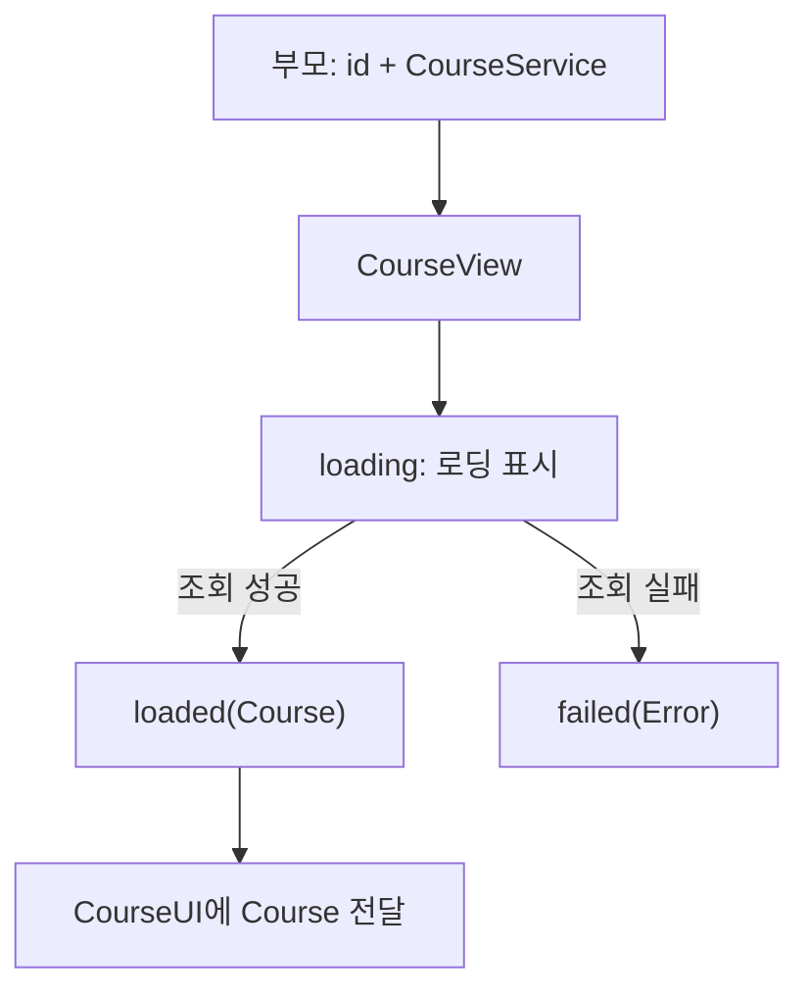

# [WEEK 19] Book 1 Chapters 5–6
📖 Mobile System Design 1. UI Frameworks, Architectures, and Supporting Multiple Products  

 

## 5. Delivering Self-Sufficient Features, Part I: The Art of Staying Nimble
> 필요한 데이터를 직접 불러오고 오류를 처리하는 feature는 부모 view에 덜 의존한다. 그래서 다른 흐름에서도 재사용하기 쉽다.  

### The problem of dependent features
부모 view가 `Course`를 먼저 조회해 전달해야 하는 구조에서는 상세 feature가 부모 view에 의존한다.  
master-detail에서는 목록 화면이 `Course`를 조회해 상세 화면에 전달한다. 상세 화면을 다른 흐름이나 deep link에서 열려면 그 위치에서도 `Course`를 조회해 전달해야 한다.  

#### Error handling
오류 처리를 부모 view에 맡기면 feature가 부모 view에 더 의존하게 된다.  
부모 view는 오류가 난 상황을 충분히 알기 어려워 alert만 띄우는 데 그치기 쉽다.  

> [!Important]
> 오류가 발생한 feature가 직접 처리하면 상황에 맞게 대응하기 쉽다.  

#### Handle errors more gracefully
오류를 알리는 데서 그치지 않고 작업을 이어가거나 다시 시도할 방법을 feature 안에 둘 수 있다.  

- 화면 안에 오류를 표시한다.
- 네트워크가 복구되면 대기 중인 작업을 재개하고 toast 알림을 보낸다.
- 데이터 계층이 정해진 간격으로 여러 번 재시도한 뒤 feature에 오류를 전달한다.
- 실패 상태를 표시해 사용자가 직접 다시 시도할 수 있게 한다.
- 작업 실패 시 앱이 백그라운드라면 앱 아이콘 badge나 local notification으로 알린다.

but 이런 복구 방법이 항상 최선의 UX인 것은 아니다.  

#### Multiple simultaneous errors
여러 feature에서 오류가 동시에 나 각자 alert를 띄우려 할 수 있다. alert는 한 번에 하나만 표시할 수 있다. 그래서 알림이 충돌하거나 차례로 이어질 수 있다.  
오류를 alert 대신 feature 안에 표시하면 다른 view에 포함해도 부모의 화면 흐름을 가로채지 않는다.  

---

### A self-sufficient feature in technical terms
self-sufficient feature는 **ID로 데이터를 불러오고 자체 오류를 처리**한다. 부모 view와 계속 정보를 주고받지 않아도 동작하며 navigation 흐름도 직접 제어하지 않는다.  

- 제한된 정보만 받아도 데이터를 직접 불러온다.
- 오류와 실패 상태를 자체적으로 처리하고 가능한 경우 복구한다.
- 부모 view와 계속 정보를 주고받지 않아도 동작한다.
- 부모의 navigation stack을 직접 제어하지 않는다.

---

### Connecting data-loading to a feature
현재는 부모가 `CourseService`로 `Course`를 가져와 `CourseView`에 전달한다.  
`CourseView`는 받은 데이터를 그릴 뿐 직접 조회하지 않는다.  
feature가 스스로 로딩하려면 `CourseView`에 조회 기능을 연결하고 loading·error 상태도 처리해야 한다.  

---

### Extending to add functionality
한 방법은 `CourseService`를 기존 `CourseView`에 추가해 데이터 로딩까지 맡기는 것이다.  
`Course`를 불러오기 전에는 값이 없으므로 필수 모델이 optional로 바뀐다. `Course`를 사용하는 하위 view들도 이 상태를 처리해야 한다.  

---

### Supporting optional data
optional `Course`를 처리하려면 todo list, tutor, schedule 같은 **하위 view에도 빈 상태가 필요**하다.  
- 화면 설계 변경과 디자이너와의 협의가 생길 수 있고 
- loading·error 상태도 추가해야 한다  
결국 `CourseView`가 더 많은 상태와 역할을 떠안게 된다.  

---

### Composition instead of extension
기존 `CourseView`는 유지하고 **바깥에 loading view를 조합**하면 로딩과 화면 표시를 나눌 수 있다.  

| 방식          | 구조                                  | 영향                                       |
| ----------- | ----------------------------------- | ---------------------------------------- |
| Extension   | `CourseView`에 `CourseService`를 추가한다 | `Course`의 optional 상태가 하위 view까지 퍼질 수 있다 |
| Composition | 로딩 view 안에 기존 `CourseView`를 둔다      | 기존 렌더링과 하위 view를 유지할 수 있다                |

#### Nesting views
기존 `CourseView`를 로딩 view 안에 넣으면 부모는 self-loading feature 하나만 사용하면 된다.  
안쪽 view는 `Course`를 그리는 역할을 유지하고 바깥 view가 데이터를 불러온다.  

> Compose에서도 `CourseRoute`가 데이터를 불러오고 `CourseContent`가 받은 `Course`를 그리도록 나눌 수 있다.  

#### Swapping the names for consistency
API 안정성을 유지하려고 로딩 wrapper가 기존 `CourseView` 이름을 이어받고 렌더링 view는 `CourseUI`로 바꾼다.  
기존 호출부는 수정할 필요가 없다. `CourseUI`를 private으로 두면 외부에 공개하는 API도 줄일 수 있다.  

---

### Dependencies and self-sufficient features
feature가 부모 화면에서 독립되어도 실행에 필요한 의존성은 그대로 남는다.  
앱 안에서 `CourseView`를 다른 화면으로 옮기면 그 위치에서 `CourseService`와 ID를 전달해야 한다. 전달이 번거롭다면 필요한 의존성을 미리 준비하는 factory를 둘 수 있다.  

#### Modularity and encapsulation
모듈 경계를 넘으면 필요한 의존성을 새 모듈에서도 사용할 수 있는지 확인해야 한다.  
필요한 의존성만 연결하려면 인터페이스나 closure를 활용할 수 있다.  

> [!Note]
> closure는 함수와 그 함수가 바깥에서 가져다 쓰는 값을 함께 묶어 전달하는 것이다. Kotlin에서는 람다를 함수 타입으로 전달할 수 있다. `suspend () -> Course`는 호출하면 비동기로 `Course`를 반환하는 함수 타입이다.  

---

### Conclusion
기존 렌더링 view를 유지하면서 로딩 기능은 바깥에서 조합할 수 있다.  
다음 장에서는 중첩한 view 구조에 `CourseService`를 연결하고 로딩과 오류 처리를 구현한다.  

---

### What we covered
- 부모 view가 필요한 데이터를 미리 조회해 넘겨야 하는 feature는 다른 흐름이나 deep link에서 재사용하기 어렵다.
- ID 조회와 자체 오류 처리는 feature가 부모 view에 덜 의존하게 해 다른 흐름으로 옮기기 쉽게 한다.
- feature는 가능한 오류를 직접 복구하되 부모의 navigation 흐름은 제어하지 않는다.
- composition으로 로딩을 기존 렌더링 view 바깥에 두면 optional 상태를 하위 view 전체에 퍼뜨리지 않아도 된다.
- 앱 안에서 feature를 옮겨도 의존성은 필요하다. 모듈 경계를 넘을 때는 필요한 의존성을 다시 확인해야 한다.

 

## 6. Delivering Self-Sufficient Features, Part II: Self-Loading Features
> self-loading feature는 부모에게 식별자와 조회 기능을 받아 필요한 데이터를 직접 불러온다. 로딩·오류 상태는 feature가 처리하고 별도 UI가 준비된 데이터를 화면에 표시한다.  

### Where we left off
바깥 `CourseView`는 로딩을 맡고 안쪽 `CourseUI`는 `Course`를 그린다.  
내부 구성이 감춰져 있어 부모는 **`CourseView` 하나만 사용**하면 된다.  

---

### A lightweight approach to connect data to UI
가장 단순한 방법은 부모가 ID와 `CourseService`를 `CourseView`에 전달하는 것이다.  
새 타입이나 인터페이스 없이 데이터를 화면에 연결할 수 있어 읽기 전용 화면에 특히 적합하다.  
하지만 이 feature에서는 todo 상태를 바꾸므로 읽기 전용이 아니다. 변경 내용을 서버와 동기화하려면 추가 처리가 필요하다.  

---

### Implementing the new CourseView
`CourseView`는 `CourseService`로 `Course`를 불러와 `CourseUI`에 전달한다.  
두 view 모두 `Course`를 사용하지만 ID와 `CourseService`는 `CourseView`만 필요하다.  

#### Three states
데이터를 불러오는 `CourseView`는 로딩 중, 성공, 실패 상태를 구분해 화면을 보여준다.  

| 상태 | 표시 |
| --- | --- |
| `loading` | 로딩 표시 |
| `loaded(Course)` | `CourseUI`에 `Course` 전달 |
| `failed(Error)` | 오류 내용 표시 |

Compose에서는 `Loading`, `Loaded`, `Failed` 상태를 `sealed interface`로 표현할 수 있다.  

---

### A self-sufficient feature in practice
ID와 `CourseService`만 있으면 `CourseView`를 다른 화면 흐름에서도 열 수 있다.  
조회가 실패하면 `CourseView`가 오류 문구를 직접 보여준다. 표현은 단순하지만 **부모가 대신 오류를 처리하지 않는 구조**이다.  

#### A deep linking example
부모가 deep link를 해석해 `Course` ID를 `CourseView`에 전달하면 목록 화면을 거치지 않고 해당 화면을 열 수 있다.  
부모는 링크 해석을 맡고 `CourseView`는 데이터 조회를 맡는다.  

---

### Increasing flexibility by removing dependencies
`CourseView`가 `CourseService`에서 사용하는 기능이 `Course` 조회 하나뿐이라면 서비스 전체 대신 **조회 함수만 전달**할 수 있다.  
그러면 데이터를 어디서 불러오는지 `CourseView`가 알 필요가 없다.  

#### Replacing a property with a closure
`CourseService`와 ID를 받는 대신 `Course`를 반환하는 **closure를 전달**할 수 있다.  
Compose에서는 비동기 로딩 함수를 `suspend () -> Course` 형태로 표현할 수 있다. closure가 조회 방식을 정하므로 ID가 필요 없는 데이터 출처도 사용할 수 있다. ID가 필요해도 closure를 만드는 쪽에서 사용하므로 `CourseView`의 API에는 드러나지 않는다.  

#### CourseView using a closure
`CourseView`는 로딩 중 전달받은 closure를 호출해 `Course`를 가져온다.  
로딩 상태 흐름은 그대로 유지하면서 `CourseService`에 직접 의존하지 않는다.  

#### The closure in action
호출부에서 `Course`를 반환하는 closure를 넘기면 데이터 출처를 바꿔 사용할 수 있다.  

| 데이터 출처 | closure가 하는 일 |
| --- | --- |
| `CourseService` | ID로 네트워크에서 `Course` 조회 |
| `CourseDatabase` | 데이터베이스에서 `Course` 조회 |
| `CourseMock` | UI 테스트용 `Course` 생성 |

#### Trade-offs when using a closure
필요한 동작이 하나뿐이라면 closure가 가볍고 나중에 쉽게 되돌릴 수 있다.  
- `CourseService`에서 조회 외의 메서드도 필요해지면 closure를 추가하거나 인터페이스를 만들 수 있다.  
- `CourseService`를 다시 직접 전달하는 방법도 있다.  
closure에 익숙하지 않은 팀원은 이름 있는 메서드보다 의도를 파악하기 어려울 수 있다.  
테스트를 위해 closure로 바꾸지 않아도 되며 네트워크 경계에서 mock하는 방법도 있다.  

#### Restoring API stability
closure만 받도록 바꾸면 기존 `CourseView(id, courseService)` 호출부가 깨진다. 기본 의존성인 `CourseService`도 API에서 드러나지 않는다.  
기존 initializer를 다시 제공해 내부에서 closure를 설정하면 호출부를 유지하면서 구현의 유연성도 얻을 수 있다.  

---

### Supporting mutation
`Store`는 조회한 `Course`를 캐시해 화면을 다시 열 때 새 네트워크 요청을 하지 않아도 된다. 하지만 캐시와 수정 상태 보존은 별개다. 현재 수정값은 `CourseView` 안에만 남아 화면을 벗어나면 사라지고 서버에도 동기화되지 않는다.  
closure는 조회에는 간단하지만 복잡한 mutation을 다루기에는 적합하지 않다.  
todo 상태가 바뀌면 `CourseView`가 `CourseService.update()`를 호출해 서버 동기화를 시작한다.  
이 단순한 구현에는 실패 처리, 재시도, 연속 변경을 묶어 보내는 debounce, 취소 로직이 없다. 업데이트가 view의 생명주기에 묶여 중단될 수도 있다.  

---

### Conclusion
`CourseView`는 데이터 로딩과 동기화를 맡고 `CourseUI`는 `Course`를 표시하며 todo 변경을 처리한다.  
composition으로 작은 타입을 조합해 추가 모델이나 ViewModel 없이 기능을 만들 수 있다. 다만 변경 상태를 보관하는 `CourseView`가 데이터의 source of truth가 된다.  

---

### What we covered
- ID 기반 로딩은 부모가 `Course`를 미리 조회해 전달하는 일을 없애 feature를 다른 흐름이나 deep link에서도 쉽게 쓰게 한다.
- `loading`·`loaded`·`failed` 상태를 나누면 조회 결과에 맞는 화면을 보여줄 수 있다.
- 작은 API와 composition은 부모의 부담을 줄이고 기존 렌더링 view를 유지한다.
- 한 가지 동작만 필요하면 closure로 구체적인 의존성을 숨길 수 있다.
- 기본 의존성이 API에서 덜 보이고 이해하기 어려울 수 있다. 기존 initializer를 함께 제공하면 자주 쓰는 초기화 방식과 호출부를 유지할 수 있다.
- 현재 mutation 방식에서는 `CourseView`가 데이터의 source of truth가 된다. 실패 복구나 view를 벗어난 뒤의 변경 상태까지 해결하지는 않는다.
