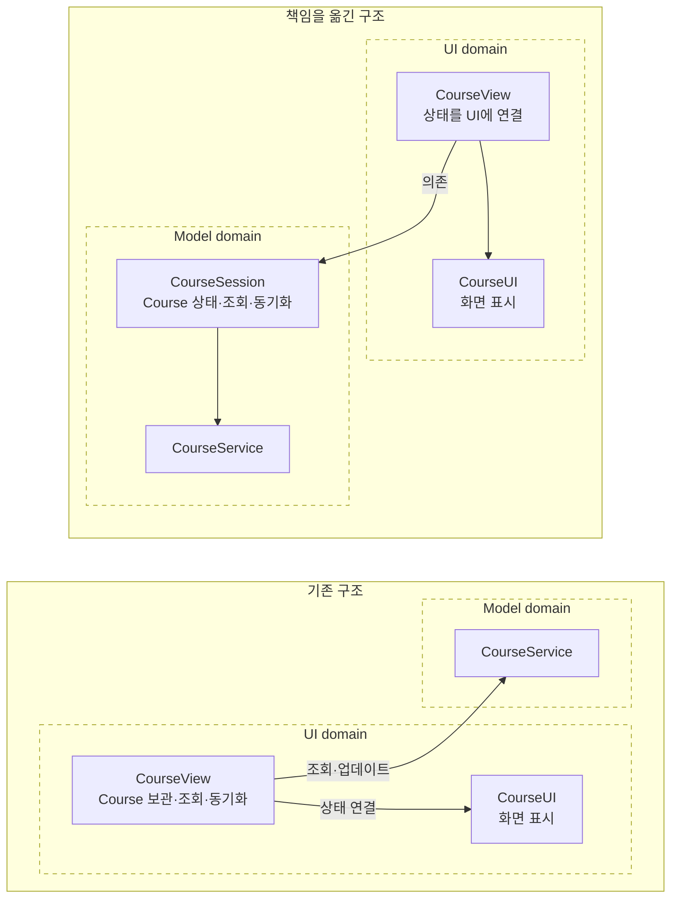
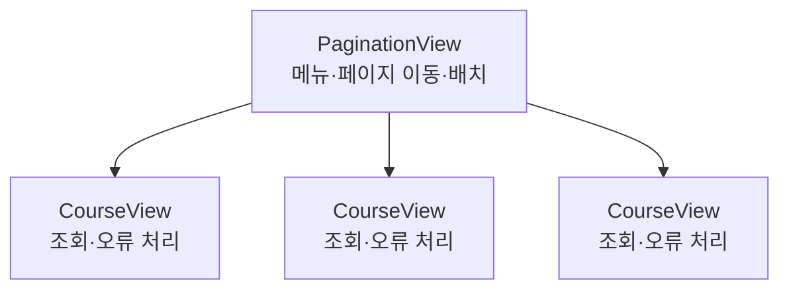
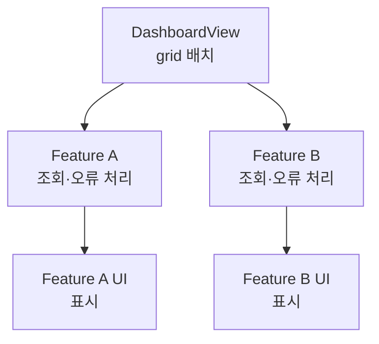
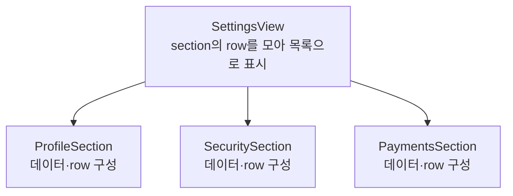

# [WEEK 20] Book 1 Chapters 7–8
📖 Mobile System Design 1. UI Frameworks, Architectures, and Supporting Multiple Products  

 

## 7. Delivering Self-Sufficient Features, Part III: Making Features Portable
> feature의 상태와 핵심 동작을 UI 밖에 두면 특정 플랫폼에 덜 묶이고 화면을 벗어난 뒤에도 기능을 이어갈 수 있다.  

### Where we left off
현재 `CourseView`는 `CourseService`로 `Course`를 불러와 직접 보관한다. 사용자가 내용을 바꾸면 `CourseView`가 `CourseService`에 업데이트를 요청한다.  

#### Why the Course feature currently isn't portable
현재 `Course`의 기준 데이터(source of truth)는 `CourseView`가 보관한다. 조회와 변경 동기화까지 UI domain에서 처리하므로 화면이 아닌 다른 곳에서 기능을 쓰려면 이 동작을 다시 구현해야 한다.  

#### Why we currently can't unit-test Course as a system
`CourseService`의 조회와 업데이트는 각각 검사할 수 있지만 두 동작이 feature 안에서 연결되는 과정은 unit test하기 어렵다. 조회 결과에 따른 성공·실패 상태와 사용자의 변경이 서버 업데이트로 이어지는 동작은 `CourseView`에 있기 때문이다.  

---

### Pushing the logic out of the UI domain
`CourseView`가 맡은 데이터 상태와 동기화 책임을 model domain으로 옮긴다. `CourseService`는 API 호출에 집중시키고 단일 `Course`의 상태를 관리할 별도 type을 둔다.  

#### Introducing a source of truth model
`CourseSession`은 한 `Course`의 조회와 상태, 변경을 맡는 model이다. `CourseView`는 `Course`를 직접 보관하지 않고 `CourseSession`의 상태를 화면과 연결한다.  

`CourseSession`을 SwiftUI 같은 UI framework에 종속시키지 않는다. 그래야 view가 없어도 사용하고 unit test할 수 있다.  

#### Moving logic to the model domain
`CourseSession`이 데이터 조회와 상태 관리, 변경 내용의 서버 동기화를 맡는다. `CourseView`는 로딩·오류 상태를 표시하고 조회된 `Course`를 `CourseUI`에 연결한다.  

#### Implementing CourseSession
`CourseSession`은 ID와 `CourseService`를 받아 `Course`를 조회한다. `loading`, `loaded`, `failed` 상태를 관리하고 같은 `Course`의 내용이 바뀌면 서버에 업데이트한다.  

Compose에서는 상태를 `sealed interface`로 표현하고 `CourseSession`이 상태를 제공할 수 있다. Compose UI가 이를 관찰해 화면을 갱신하면 된다. 전용 `ViewModel`이 필수인 것은 아니다.  

#### Simplifying CourseView
`CourseView`는 `CourseSession`의 상태를 화면에 연결하는 얇은 UI가 된다. 별도 type과 간접 계층이 늘지만 source of truth가 분명해지고 기능을 UI 없이 쓰기 쉬워진다.  

---

### Verifying our new implementation
`CourseSession`으로 옮긴 책임이 화면 밖에서도 기능을 유지하고 더 쉽게 검증하게 하는지 살펴본다.  

#### Detaching a feature from a screen
화면을 닫아도 `CourseSession`이 살아 있으면 조회와 서버 동기화가 계속된다. 같은 session을 다시 화면에 연결하면 최신 상태를 볼 수 있다. 화면이 없는 동안의 변경은 notification이나 toast로 알릴 수도 있다.  

> [!Note]
> 여기서 화면을 벗어난 뒤에도 동작한다는 말은 `CourseSession`이 UI와 분리되어 있다는 뜻이다. OS가 앱을 백그라운드에서 계속 실행해 준다는 보장은 아니다.  

#### Supporting other platforms and patterns
`CourseSession`이 조회와 변경 동기화를 맡으므로 UIKit 같은 다른 UI에서도 기능을 다시 만들 필요가 없다. 새 UI에 맞게 session을 연결하는 부분만 구현하면 된다.  

#### Maturing syncing logic
동기화 로직을 `CourseSession` 안에서 발전시킬 수 있다. 연속 변경이 잠시 멈춘 뒤 요청하는 debounce와 진행 중인 요청의 취소를 추가할 수 있으며 retry도 확장할 수 있다.  

#### Unit tests instead of manual UI checks
`CourseSession`을 직접 검사해 `Course` 변경이 서버 업데이트로 이어지는지 확인할 수 있다. 같은 상태의 변경을 무시하는지와 debounce·취소가 동작하는지도 UI를 조작하지 않고 test할 수 있다.  

---

### Conclusion
UI에 연결하는 방식은 플랫폼마다 달라질 수 있다. feature의 상태와 핵심 로직을 model domain에 두면 UI를 바꾸거나 화면을 벗어나도 기능을 이어갈 수 있다.  

---

### What we covered
- feature가 UI에 덜 의존할수록 다른 화면과 플랫폼, UI 방식에서 재사용하기 쉽다.
- view가 데이터를 불러오고 상태를 소유한다면 source of truth가 UI domain에 있는지 살펴본다.
- model domain으로 책임을 옮기면 화면을 벗어난 뒤에도 기능을 이어가기 쉽다.
- UI 밖에서 기능이 계속 동작하려면 화면이 없는 동안 사용자에게 알릴 방법도 고려해야 한다.
- debounce와 취소처럼 복잡한 동기화 로직도 UI 밖에서 발전시킬 수 있다.

 

## 8. Taming Complex UI
> 복잡도는 없애기 어렵다. 큰 view 하나에 몰아넣기보다 역할이 분명한 feature와 type으로 나누면 관리하기 쉽다.  

### Use case #1: Pagination
여러 `Course`를 넘겨 보는 pagination을 추가한다. 각 `CourseView`가 스스로 데이터를 불러오고 오류를 처리하면 부모는 페이지 배치에 집중할 수 있다.  

#### Postponing can positively impact development
처음부터 여러 `Course`를 지원하지 않고 단일 course 기능을 먼저 출시하면 더 빨리 사용자의 반응을 확인할 수 있다. 실제 요구가 확인된 뒤에는 이미 동작하는 self-sufficient `CourseView`를 조합해 pagination을 만들 수 있다.  

#### The technical design
`PaginationView`가 가로 메뉴와 페이지 이동을 맡고 여러 `CourseView`를 나란히 배치한다. 책의 예시는 최대 세 개를 재사용해 무한히 넘기는 것처럼 보이게 한다.  

#### Self-sufficient features pay off
각 `CourseView`가 조회와 오류를 처리하므로 `PaginationView`는 페이지 이동과 배치에 집중한다. 부모가 각 화면의 데이터와 오류, navigation을 일일이 관리하지 않아도 된다.  

---

### Use case #2: Bento-Box UI
`DashboardView` 하나에 여러 feature를 배치하는 상황이다. 화면의 겉모습은 단순한 grid여도 각 feature가 데이터와 오류, permission을 요구하면 내부 책임은 복잡해진다.  

#### A flat hierarchy
여러 feature를 얕은 view 계층에 욱여넣으면 `DashboardView`가 대부분의 작업을 떠안기 쉽다. 부모가 직접 처리할수록 view 계층이 얕고 복잡해진다.  

#### Showcasing complexity
모든 데이터 조회와 오류 처리, 사용자 동작을 `DashboardView`가 담당하면 dependency와 비동기 작업이 한곳에 모인다. 단순한 하위 view를 연결하는 대신 부모가 거대한 조정자처럼 변한다.  

#### Pushing out responsibilities
각 하위 feature가 필요한 dependency를 받고 데이터 조회와 오류 처리를 맡게 한다. 그러면 `DashboardView`는 feature의 내용을 관리하지 않고 grid에 배치하는 데 집중한다.  

#### Disconnected features
feature가 각자 데이터를 불러오고 실패를 처리하면 한 feature의 오류가 다른 feature를 막지 않는다. 다만 하위 feature 자체의 복잡도는 여전히 남아 있다.  

#### A deeper hierarchy
하위 feature도 복잡하다면 로딩과 오류를 담당하는 feature view와 화면만 그리는 간단한 UI를 나눈다. 구조는 `DashboardView → feature → UI`가 되고 각 type이 맡는 일이 작아진다.  

---

### Evaluating our approach
계층을 나누면 type과 abstraction이 늘어난다. 복잡도 자체가 사라지는 것은 아니므로 어디에 둘지 선택해야 한다.  

#### A bug occurs
feature 데이터 문제는 해당 feature에서 찾고 grid 배치 문제는 `DashboardView`에서 찾을 수 있다. 역할이 나뉘면 관련 없는 코드를 훑지 않고 문제 영역을 좁힐 수 있다.  

#### Transforming a complex screen problem into a simpler dependency problem
복잡한 화면을 작은 type으로 나눠도 전체 복잡도가 없어지지는 않는다. 화면의 거대한 로직이 dependency를 필요한 곳에 전달하는 문제로 바뀐다. 부모는 하위 feature를 배치하고 각 feature는 자신의 동작을 맡는다.  

#### When feature views need to interoperate
feature끼리 drag-and-drop처럼 UI에서 협력해야 한다면 부모가 조정할 수 있다. 여러 feature 사이의 UI 동작을 연결하는 일은 부모 view의 책임으로 두어도 된다.  

#### Syncing model changes
여러 feature가 같은 model 변경을 알아야 한다면 UI 부모에 연결 로직을 몰기보다 model domain에 구독 구조를 둘 수 있다. 각 feature가 변경을 구독하면 UI와 독립적으로 동기화하고 test할 수 있다.  

> [!Note]
> pub/sub는 한 publisher가 변경을 알리고 여러 subscriber가 이를 받아 반응하는 방식이다.  

---

### Use case #3: Simple UI, complex functionality
단순한 목록도 각 항목이 서로 다른 기능과 dependency를 맡으면 복잡해진다. tutor 설정 목록을 예로 구조를 나눈다.  

#### A tutor's settings
프로필·보안·결제·개인정보 같은 여러 설정을 한 화면에 모으면 목록 하나가 여러 기능을 함께 담게 된다.  

#### A naive approach
모든 설정의 dependency와 비동기 작업, 상태를 `SettingsView`에 넣으면 단순해 보이는 목록이 거대한 view가 된다. 항목을 추가할수록 부모가 알아야 할 기능도 늘어난다.  

#### Creating a hierarchy, again
설정을 별도 화면으로 나누면 화면과 데이터 책임을 category별로 분리할 수 있다. 각 화면이 작아지는 대신 화면 사이에 dependency를 전달해야 한다.  

#### Disconnecting UI from the functionality
하나의 목록을 유지해야 한다면 각 설정 영역을 section type으로 나눈다. section은 자체 데이터와 상태를 관리하고 부모에 row를 제공한다. 부모는 row를 한 목록으로 그려 일관된 UI를 유지한다.  

#### Fewer dependencies
`SettingsView`는 각 API를 직접 알 필요 없이 section 하나씩만 의존한다. section 내부 dependency와 row 구성은 해당 section이 맡는다.  

#### More granularity
section 하나가 지나치게 복잡할 때만 row도 별도 type으로 나눈다. 더 세밀하게 관리할 수 있지만 type이 늘어나는 비용이 있으므로 필요한 경우에 적용한다.  

---

### Conclusion
feature는 항상 전체 화면과 같지 않다. self-sufficient feature를 적절한 계층으로 조합하면 한 화면에 여러 기능을 넣거나 복잡한 목록을 유지하면서도 책임을 나눌 수 있다.  

복잡도는 기능을 없애지 않는 한 남는다. type을 늘리는 비용을 감수하고 역할을 분명히 하면 큰 view 하나보다 이해하고 수정하기 쉬운 구조를 만들 수 있다.  

---

### What we covered
- 덜 중요한 요구사항을 미루면 실제 정보에 기반해 다음 구조를 정할 수 있다.
- self-sufficient feature는 다른 feature와 조합하기 쉽고 부모의 부담을 줄인다.
- 화면의 복잡도는 하위 feature로 나누고 필요하면 UI 표현과 기능도 분리한다.
- 복잡도를 줄인다는 것은 없애는 일이 아니라 더 작은 type에 나눠 관리하는 일이다.
- 하나의 목록 UI도 section이나 row를 별도 type으로 나눠 내부 기능을 분리할 수 있다.
- feature끼리 협력해야 할 때는 UI 조정은 부모에 두고 공유 model 변경은 model domain에서 연결할 수 있다.
