```table-of-contents
```

## 7장 [[10. Projects/Mobile System Design/StudyVault/UI-07-Self-Sufficient-Features-III/07. 자급자족 피처 III|자급자족 피처 III]]

> UI가 사라져도 피처는 자기 일을 계속할 수 있는가?

- **이식 가능한 피처는 특정 UI 패턴이나 프레임워크에 과하게 기대지 않고 동작하는 피처다.**
    - 화면을 다른 플로우에 넣는 것을 넘어, 다른 UI 구현이나 UI가 없는 환경에서도 핵심 동작을 쓸 수 있다.
    - 그러려면 피처의 데이터와 상태를 UI 밖에서 소유해야 한다.

- [[10. Projects/Mobile System Design/Study-Summaries/UI/06. 자급자족 피처 II|6장]] 에서 만든 `CourseView` 는 스스로 로드하고 변경도 전달한다.
    - 하지만 코스를 보관하고, 로딩 결과에 따라 상태를 바꾸고, 변경 시 동기화를 시작하는 주체가 모두 뷰다.
    - 이번 장에서는 그 책임을 모델 도메인의 `CourseSession` 으로 옮긴다.

### 자급자족과 이식성은 어디서 이어지는가

- 피처가 특정 UI 구현에 묶여 있으면 UI를 바꿀 때 비즈니스 동작도 함께 옮겨야 한다.
    - SwiftUI에서 UIKit으로 옮길 때 코스 로딩과 변경 동기화를 다시 연결해야 한다.
    - Android의 View 기반 화면을 Compose로 바꿀 때도 같은 책임 경계를 살펴볼 수 있다.

- UI 밖에서도 쓸 수 있는 피처는 활용 범위가 넓어진다.
    - 다른 화면이나 타겟에서 같은 동작을 사용할 수 있다.
    - 화면 없이 작업을 수행하거나 단위 테스트로 검증하기 쉬워진다.
    - UI를 교체할 때 상태를 표시하고 입력을 전달하는 연결 부분에 집중할 수 있다.

- 이식성은 전부 갖추거나 전혀 없는 이분법적인 속성이 아니다.
    - 로직을 조금씩 UI 밖으로 옮기며 높일 수 있다.
    - 화면 자체에는 여전히 플랫폼에 맞는 UI와 연결 코드가 필요하다.
    - **목표는 모든 UI 코드를 공통화하는 것이 아니라, 피처의 핵심 동작이 UI에 덜 기대게 하는 것이다.**

### 현재 상태의 원본은 CourseView다

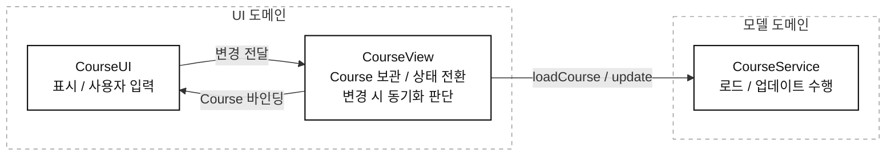

- `CourseService` 는 데이터를 반환하지만, 이 피처에서 현재 사용하는 코스를 보관하는 것은 `CourseView` 다.
    - 로딩 성공을 `Loaded` 로 바꾸는 것도 뷰다.
    - 실패를 `Failed` 로 바꾸는 것도 뷰다.
    - 사용자가 변경한 코스를 받아 저장을 요청하는 것도 뷰다.

- 이 의미에서 `CourseView` 가 피처 상태의 원본인 `Source of Truth` 다.
    - 단순히 서버에서 데이터를 가져오는 타입을 가리키는 말이 아니다.
    - **현재 피처 상태를 소유하고, 변경을 반영하는 기준점이 어디인지**를 묻는 것이다.

- 이 책임이 UI에 있으면 서비스만 테스트해서는 피처 전체를 확인하기 어렵다.

| 서비스만 테스트해서 확인할 수 있는 것 | 현재 구조에서 UI에 남아 있는 것 |
| --- | --- |
| `loadCourse` 가 코스를 반환하는가 | 성공 후 피처 상태가 `Loaded` 가 되는가 |
| 로드 실패가 전달되는가 | 실패 후 피처 상태가 `Failed` 가 되는가 |
| `update` 가 올바른 요청을 보내는가 | 사용자의 변경이 실제 `update` 호출로 이어지는가 |

- 메소드 자체가 동작하는 것과 그 메소드들이 피처 안에서 연결되어 동작하는 것은 다르다.
    - [[10. Projects/Mobile System Design/Study-Summaries/Fundamentals/05. 시스템 전반 테스트 정리|시스템 전반 테스트 정리]] 에서 다룬 것처럼, 동작의 연결까지 검증할 수 있어야 한다.

### CourseSession을 도입한다

#### 왜 CourseService에 전부 넣지 않는가?

- `CourseService` 는 여러 코스의 로드와 업데이트를 처리할 수 있어야 한다.
    - 반면 지금 필요한 것은 **특정 코스 하나의 현재 상태를 유지하는 객체**다.
    - 둘을 합치면 서비스가 API 작업과 개별 코스의 세션 상태를 함께 관리하게 된다.

- 그래서 단일 코스의 로딩, 실패 상태, 변경을 맡는 `CourseSession` 을 둔다.
    - 이 책의 문제에 맞는 선택이지 모든 앱에 같은 타입이 필요하다는 뜻은 아니다.
    - 중요한 기준은 로직과 상태가 모델 도메인으로 이동한다는 점이다.

#### 각 타입의 역할

| 타입              | 맡는 책임                            |
| --------------- | -------------------------------- |
| `CourseService` | 코스를 로드하고 업데이트하는 작업 수행            |
| `CourseSession` | 단일 코스의 상태 소유, 로딩 결과 반영, 변경 시 동기화 |
| `CourseView`    | 세션 상태를 UI에 연결하고 사용자 변경 전달        |
| `CourseUI`      | 준비된 코스의 콘텐츠 렌더링과 입력 처리           |

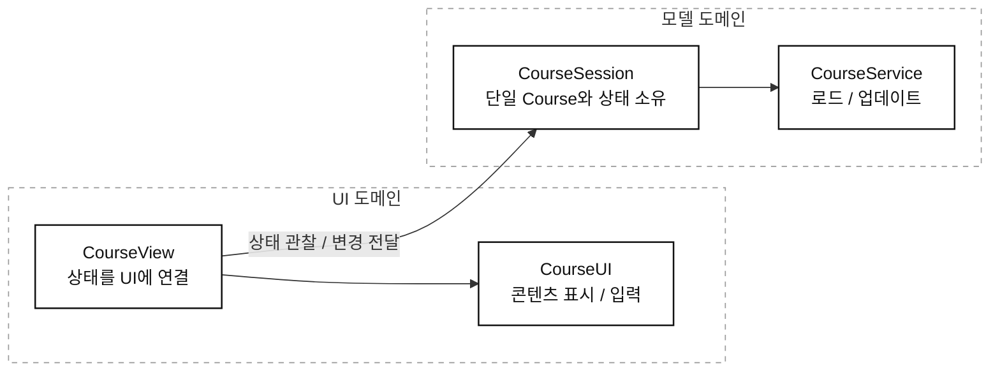

- `CourseView` 는 코스 상태를 별도로 소유하지 않는다.
    - 세션의 상태를 읽고 어떤 UI를 보여줄지 결정한다.
    - `CourseUI` 에서 받은 변경을 세션으로 전달한다.

- 책에서는 이 타입을 `ViewModel` 대신 `CourseSession` 이라고 부른다.
    - 뷰의 존재를 몰라도 동작하고, 뷰가 아닌 코드에서도 사용할 수 있기 때문이다.
    - 이름 자체보다 **UI에 의존하지 않는 책임과 수명**이 중요하다.

### 로딩과 변경을 모델 도메인으로 옮긴다

#### 로딩 흐름

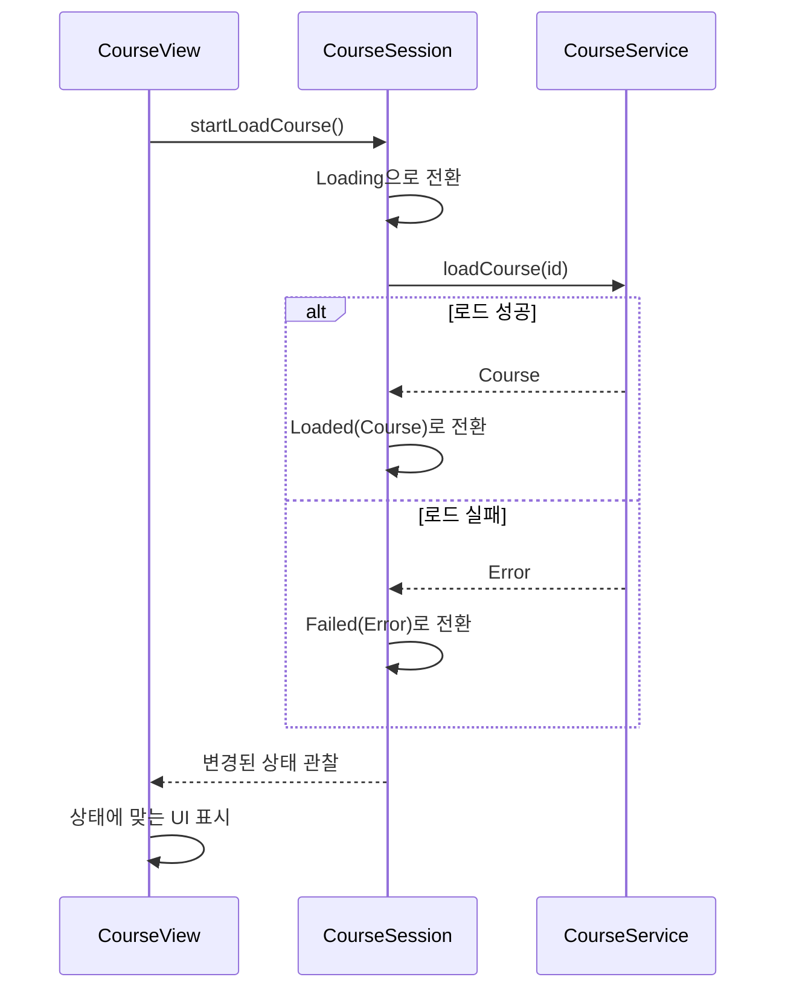

- 뷰가 로드를 시작하라는 신호를 보낼 수는 있다.
    - 하지만 로드 결과를 해석하고 상태를 전환하는 주체는 세션이다.
    - 누가 작업을 시작하는지와 누가 작업의 로직을 소유하는지는 구분한다.

- 원문의 `CourseSession` 은 두 가지 초기화 방식을 제공한다.
    - `id` 와 `CourseService` 를 받아 직접 로드하는 방식이다.
    - 이미 준비된 `Course` 를 받아 완료 상태로 시작하는 방식이다.
        - 이 경로에는 서비스가 없으므로 서버 동기화도 수행하지 않는다.

#### StateFlow로 상태를 공개한다

- Kotlin에서는 세션이 `MutableStateFlow` 로 상태를 소유하고, 외부에는 읽기 전용 `StateFlow` 를 공개할 수 있다.
    - 상태를 바꾸는 코드는 세션 안에 둔다.
    - 화면은 현재 상태를 관찰하고, 변경이 필요하면 세션의 메소드를 호출한다.
    - 모델은 Compose의 `State` 나 Android의 `Lifecycle` 을 몰라도 된다.

- 다음은 `id` 로 로드하는 경로를 옮긴 예제다.
    - `LoadState` 는 6장에서 정의한 타입을 사용한다.
    - 메소드는 Main에서 호출하고, 외부 소유자가 Main에서 실행되는 `CoroutineScope` 를 전달한다고 가정한다.
    - `CourseService` 의 메소드는 Main을 막지 않고 취소에 협력하는 `suspend` 함수다.

```kotlin
class CourseSession(
    private val id: UUID,
    private val courseService: CourseService,
    private val scope: CoroutineScope,
) {
    private val _state = MutableStateFlow<LoadState>(LoadState.Loading)
    val state: StateFlow<LoadState> = _state.asStateFlow()

    private val _syncError = MutableStateFlow<Throwable?>(null)
    val syncError: StateFlow<Throwable?> = _syncError.asStateFlow()

    private var loadJob: Job? = null
    private var updateJob: Job? = null

    fun startLoadCourse() {
        if (loadJob?.isActive == true || _state.value is LoadState.Loaded) return

        _state.value = LoadState.Loading
        loadJob = scope.launch {
            try {
                _state.value = LoadState.Loaded(courseService.loadCourse(id))
            } catch (cancelled: CancellationException) {
                throw cancelled
            } catch (error: Exception) {
                _state.value = LoadState.Failed(error)
            }
        }
    }

    fun updateCourse(updatedCourse: Course) {
        val current = (_state.value as? LoadState.Loaded)?.course ?: return
        if (current.id != updatedCourse.id || current == updatedCourse) return

        _state.value = LoadState.Loaded(updatedCourse)
        sync(updatedCourse)
    }

    private fun sync(course: Course) {
        updateJob?.cancel()
        _syncError.value = null
        updateJob = scope.launch {
            try {
                courseService.update(course)
            } catch (cancelled: CancellationException) {
                throw cancelled
            } catch (error: Exception) {
                _syncError.value = error
            }
        }
    }

    fun close() {
        loadJob?.cancel()
        updateJob?.cancel()
    }
}
```

- `state` 는 로딩과 콘텐츠 상태이고, `syncError` 는 이미 표시한 콘텐츠를 저장하다 실패한 상태다.
    - 저장에 실패했다고 코스 자체를 화면에서 없애지 않도록 따로 둔다.
    - 로컬 변경을 먼저 표시하고 서버에 전달하므로, 실패 시 재시도나 되돌리기 정책은 추가로 정해야 한다.

- 코스와 내부 항목은 새 값으로 교체한다고 가정한다.
    - `StateFlow` 는 `equals` 기준으로 같은 값의 방출을 생략한다.
    - 객체 내부를 직접 수정하고 같은 객체를 다시 넣으면 변경이 관찰되지 않을 수 있다.

#### 변경 흐름

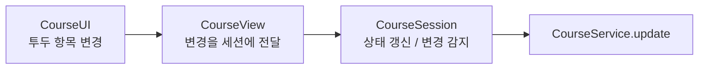

- 위 예제는 사용자 변경을 `updateCourse` 라는 명시적인 메소드로 받는다.
    - 로드된 코스가 있는지, 같은 코스를 수정했는지 확인한다.
    - 내용까지 같으면 불필요한 업데이트를 생략한다.
    - 로컬 상태를 바꾼 뒤 서버 동기화를 요청한다.

- 로드 완료와 사용자 변경이 서로 다른 경로를 탄다.
    - `startLoadCourse` 는 상태만 갱신한다.
    - `updateCourse` 는 상태 갱신과 동기화를 함께 요청한다.
    - 따라서 최초 `Loading → Loaded` 전환 때문에 저장 요청이 발생하지 않는다.

#### Compose는 상태를 구독하고 변경을 전달한다

- 화면에서는 `collectAsStateWithLifecycle` 로 세션의 상태를 읽는다.
    - Android의 Lifecycle에 맞춰 수집을 중단하거나 재개한다.
    - 관찰한 값이 바뀌면 해당 값을 읽는 UI가 다시 구성된다.
    - 사용자의 변경은 `session::updateCourse` 로 돌려보낸다.

```kotlin
@Composable
fun CourseView(session: CourseSession) {
    val state by session.state.collectAsStateWithLifecycle()
    val syncError by session.syncError.collectAsStateWithLifecycle()

    LaunchedEffect(session) {
        session.startLoadCourse()
    }

    Column {
        when (val current = state) {
            LoadState.Loading -> CircularProgressIndicator()
            is LoadState.Failed -> Text("코스를 불러오지 못했다.")
            is LoadState.Loaded -> CourseUI(
                course = current.course,
                onCourseChange = session::updateCourse,
            )
        }

        if (syncError != null) {
            Text("변경 사항을 저장하지 못했다.")
        }
    }
}
```

- **`CourseView` 에는 `CourseService` 호출이나 상태를 직접 바꾸는 코드가 없다.**
    - 로딩 결과와 변경 처리는 `CourseSession` 에 남는다.
    - 다른 UI를 사용할 때는 `StateFlow` 를 그 UI에 연결하는 부분만 바꾸면 된다.

- `LaunchedEffect` 는 여기서 시작 신호만 보낸다.
    - 실제 로딩 작업은 세션에 전달된 `scope` 에서 실행된다.
    - 6장처럼 `LaunchedEffect` 안에서 네트워크 작업이 끝날 때까지 기다리는 구조와 수명이 다르다.

### 화면과 피처의 수명을 나눈다

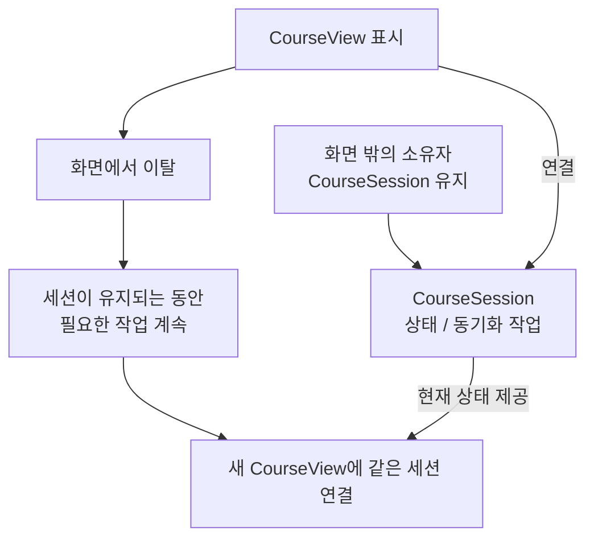

- 세션을 화면 밖에서 유지하면 화면이 없어져도 피처 상태를 유지할 수 있다.
    - 사용자가 돌아오면 같은 세션을 다시 연결할 수 있다.
    - 이미 로드된 상태라면 처음부터 코스를 다시 로드할 필요가 없다.

- **타입을 분리하는 것과 수명을 보장하는 것은 별개의 일이다.**
    - 화면보다 오래 동작해야 한다면 화면 밖의 소유자가 세션을 유지해야 한다.
    - 예제의 `scope` 도 필요한 작업 수명보다 먼저 취소되지 않아야 한다.
    - 여기서 화면 밖에서 동작한다는 설명을 앱 종료 후 실행까지 자동으로 보장한다는 뜻으로 읽으면 안 된다.

- 화면과 함께 취소되는 `rememberCoroutineScope` 를 전달하면 화면을 떠날 때 세션의 작업도 취소된다.
    - 화면 밖의 소유자가 세션과 작업 수명을 함께 관리해야 한다.
    - 그 소유자가 세션 사용을 끝낼 때 `close()` 로 남은 작업을 취소한다.
    - 화면의 구독 종료와 세션의 작업 종료를 같은 것으로 취급하지 않는다.

- 화면이 없어도 결과가 생길 수 있으므로 결과를 알리는 방식도 달라진다.
    - 현재 화면 대신 토스트나 알림으로 작업 상태를 알려줄 수 있다.
    - 여러 코스가 동시에 갱신된다면 결과를 묶거나 어떤 결과를 보여줄지 정해야 한다.

### 동기화 로직을 뷰와 무관하게 개선한다

- 사용자가 투두 항목을 빠르게 여러 번 바꾸면 매번 요청을 보내는 것이 낭비일 수 있다.
    - 디바운싱은 입력이 잠시 멈출 때까지 기다렸다가 최신 변경을 전송하는 방식이다.
    - 이 정책을 `CourseSession` 에 넣으면 `CourseView` 를 수정할 필요가 없다.

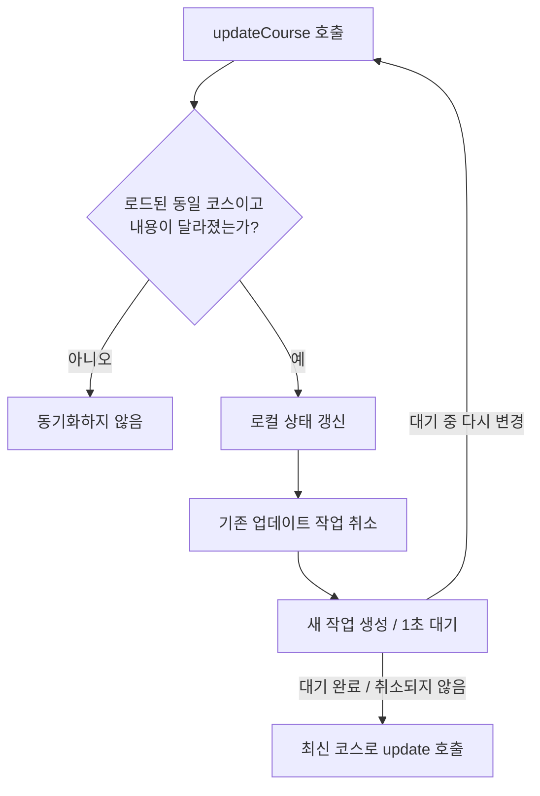

- 앞의 `sync` 메소드에 `delay` 를 추가하면 디바운싱을 적용할 수 있다.
    - 새 변경이 들어오면 기존 `Job` 을 취소한다.
    - 새 작업은 1초 동안 추가 변경이 없을 때 서버에 전달한다.

```kotlin
// CourseSession의 sync 메소드를 교체한다.
private fun sync(course: Course) {
    updateJob?.cancel()
    _syncError.value = null
    updateJob = scope.launch {
        try {
            delay(1_000)
            courseService.update(course)
        } catch (cancelled: CancellationException) {
            throw cancelled
        } catch (error: Exception) {
            _syncError.value = error
        }
    }
}
```

- `delay` 중 취소되면 예외가 발생하므로 그 아래의 `update` 를 실행하지 않는다.
    - 세션의 `close()` 도 같은 `Job` 을 취소한다.
    - 이미 서버에 전달된 요청을 취소하는 것이 서버의 변경까지 되돌리는 것은 아니다.

- 이 구조는 동기화 정책을 더 발전시킬 자리를 만든다.
    - 재시도나 요청 순서 보장도 모델 쪽에서 다룰 수 있다.
    - 현재 예제는 저장 실패를 표시할 수 있게 했지만, 실패를 회복하는 정책까지 구현한 것은 아니다.

### 이제 UI 없이 무엇을 테스트할 수 있는가

- 세션을 직접 사용하면 로드부터 상태 전환까지 확인할 수 있다.
    - 성공한 데이터가 완료 상태에 들어가는지 검증한다.
    - 로드 실패가 실패 상태로 반영되는지 검증한다.

- 변경이 동기화로 이어지는 흐름도 확인할 수 있다.
    - 변경된 데이터로 `update` 가 호출되는지 검증한다.
    - 디바운싱이 마지막 변경을 전달하는지 검증한다.
    - 취소된 작업이 업데이트를 진행하지 않는지 검증한다.

- 화면 렌더링과 사용자 입력의 연결까지 모든 테스트가 사라지는 것은 아니다.
    - 핵심 로직을 검증하기 위해 화면을 띄워야 하는 범위가 줄어든다.
    - 서비스 메소드 하나씩의 성공 여부를 넘어, 피처 동작의 연결을 검증하기 쉬워진다.

### 새 타입을 도입한 비용은 있는가

- `CourseSession` 만큼 타입과 간접 계층이 하나 늘어난다.
    - 단순히 읽어서 보여주기만 하는 화면이라면 6장의 가벼운 방식으로 충분할 수 있다.
    - 모든 화면에 세션을 기계적으로 추가할 이유는 없다.

- 반면 상태 유지, 변경 동기화, UI 교체, 단위 테스트가 중요하면 얻는 것이 분명하다.
    - 현재 상태의 소유자가 명확해진다.
    - UI 구현과 피처 동작을 각각 바꿀 수 있다.
    - 화면이 없어도 피처를 사용할 수 있다.

### 정리

- 로딩을 시작하는 호출이 뷰에 있어도, 로딩과 상태 전환의 책임까지 뷰에 둘 필요는 없다.
- `CourseSession` 은 단일 코스의 상태를 소유하고, `CourseView` 는 이를 UI에 연결한다.
- 화면과 세션의 수명을 분리하면 피처를 떼었다가 다시 붙일 수 있다.
- 동기화 로직이 모델 도메인에 있으면 UI 없이 개선하고 검증하기 쉽다.

> UI는 피처 상태의 주인이 아니라, 모델이 가진 상태를 보여주고 입력을 전달하는 얇은 층이 된다.

---

## 8장 [[10. Projects/Mobile System Design/StudyVault/UI-08-Taming-Complex-UI/08. 복잡한 UI 길들이기|복잡한 UI 길들이기]]

> 복잡성은 어딘가에 있어야 한다. 어느 타입이 얼마나 감당할지 정하는 것이 설계다.

- 이 장에서 복잡한 UI는 단순히 요소가 많거나 화려한 화면을 뜻하지 않는다.
    - 로딩, 상태, 에러, 비동기 호출, 사용자 입력 처리가 한 뷰에 몰린 상황을 뜻한다.
    - 겉으로는 평범한 설정 목록도 내부 책임이 많으면 충분히 복잡하다.

- **부모가 모든 것을 알고 처리해야 한다는 전제를 내려놓는다.**
    - 각 피처가 자기 일을 감당하면 부모는 배치와 조합에 집중할 수 있다.
    - 복잡성을 없애기보다, 한 번에 이해할 수 있는 크기로 나눠 소유하게 한다.

- 세 가지 사례로 같은 원칙을 살펴본다.
    - 여러 코스를 넘겨보는 페이지네이션이다.
    - 여러 피처를 한 화면에 배치하는 대시보드다.
    - 단순한 목록 안에 다양한 기능이 들어 있는 설정 화면이다.

### 페이지네이션 : 기존 피처를 감싼다

#### 기능을 미뤘기 때문에 더 잘 보이는 구조

- 처음에는 단일 코스를 지원하는 `CourseView` 부터 구현했다.
    - 여러 코스를 오가는 메뉴는 미뤘다.
    - 핵심 기능을 먼저 전달하고, 실제 사용자의 필요를 확인할 수 있었다.

- 여러 코스 지원이 필요해진 시점에는 이미 자급자족 `CourseView` 가 있다.
    - 처음부터 구현했다면 가로 메뉴와 페이지 전환을 `CourseView` 안에 넣었을 수 있다.
    - 이제는 완성된 피처를 감싸는 별도 구조를 생각할 수 있다.
    - **기능을 미루는 것은 판단을 위한 정보를 더 얻는 방법이기도 하다.**

#### PaginationView의 역할

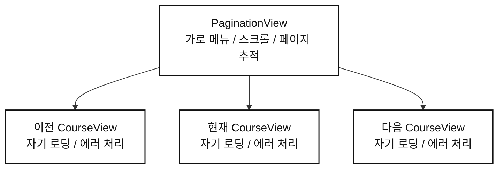

- 새 부모 `PaginationView` 가 가로 메뉴와 여러 페이지를 관리한다.
    - 원문 설계에서는 최대 세 개의 `CourseView` 를 배치한다.
    - 스크롤하면서 필요한 뷰를 재사용하거나 생성한다.
    - 이는 해당 예제의 설계이며, 모든 플랫폼의 페이지 구현이 반드시 세 개를 유지해야 한다는 규칙은 아니다.

- 각 `CourseView` 는 자신의 로딩과 실패를 처리한다.
    - 한 페이지가 실패해도 그 페이지 안에서 에러를 표시할 수 있다.
    - 부모의 내비게이션을 임의로 바꾸지 않는다.
    - `PaginationView` 가 각 코스의 내부 상태를 돌볼 필요가 줄어든다.

- 자급자족이 아니었다면 부모가 코스 로딩과 에러 처리까지 떠안을 수 있다.
    - 그 결과 코스 도메인을 깊이 아는 `CoursePaginationView` 가 되기 쉽다.
    - 페이지 배치 책임과 각 코스의 동작 책임이 뒤섞인다.

| 타입 | 알아야 하는 것 |
| --- | --- |
| `PaginationView` | 페이지 배치, 현재 페이지, 가로 메뉴, 페이지를 제공받는 방법 |
| `CourseView` | 해당 코스의 표시와 로딩 상태 연결 |
| 피처를 조립하는 코드 | 각 페이지에 필요한 데이터와 의존성을 준비하는 방법 |

- 페이지를 제공하는 구체적인 방식은 플랫폼에 맞춰 선택한다.
    - 데이터와 뷰 재사용을 연결할 수도 있다.
    - 필요한 뷰를 만드는 팩토리를 전달할 수도 있다.
    - 플랫폼이 제공하는 페이지 컴포넌트를 쓸 수도 있다.

- 내비게이션 의존성도 각 피처를 만들 때 연결할 수 있다.
    - 그러면 페이지 부모가 모든 피처의 이동 경로를 알 필요가 없다.
    - 이 장의 핵심은 커스텀 페이저 구현보다 **피처를 조합하기 좋은 상태로 준비하는 것**이다.

#### 코드로 보면 : Pager 는 Course 를 몰라도 된다

- Compose에서는 `HorizontalPager` 에 각 페이지의 콘텐츠를 넘길 수 있다.
    - `PaginationView` 는 항목의 종류와 로딩 방법을 모른다.
    - 페이지 수와 항목별 키를 사용해 전달받은 콘텐츠를 배치한다.

```kotlin
@Composable
fun <T> PaginationView(
    items: List<T>,
    itemKey: (T) -> String,
    pageContent: @Composable (T) -> Unit,
) {
    val pagerState = rememberPagerState(pageCount = { items.size })

    HorizontalPager(
        state = pagerState,
        key = { index -> itemKey(items[index]) },
    ) { index ->
        pageContent(items[index])
    }
}
```

- 코스를 연결하는 쪽에서 7장의 `CourseView` 를 페이지 콘텐츠로 넘긴다.
    - `sessionFor` 는 화면 밖의 소유자가 관리하는 코스별 세션을 반환하는 함수라고 가정한다.
    - 같은 코스에는 같은 세션을 반환하므로 페이지가 다시 만들어져도 상태를 이어 쓸 수 있다.

```kotlin
@Composable
fun CoursesPager(
    courseIds: List<UUID>,
    sessionFor: (UUID) -> CourseSession,
) {
    PaginationView(items = courseIds, itemKey = { it.toString() }) { id ->
        val session = remember(id, sessionFor) { sessionFor(id) }
        CourseView(session = session)
    }
}
```

- 각 `CourseView` 가 자기 세션의 로딩과 에러를 표시한다.
    - 페이저에는 `CourseService` 호출이나 에러 분기가 없다.
    - 세션을 언제 종료할지는 페이지 재사용과 별개로 외부 소유자가 정한다.

- `HorizontalPager` 가 필요한 페이지를 구성하므로 세 개의 뷰를 직접 관리하지 않아도 된다.
    - 예제는 페이지 조합에 집중해 가로 메뉴를 생략했다.
    - 메뉴를 추가하면 현재 선택은 `pagerState.currentPage` 에 연결하고, 탭 선택 시 페이지를 이동시키면 된다.

### 벤토 박스 UI : 한 화면에 여러 피처가 있다

- 튜터용 대시보드에 답하지 않은 채팅, 최근 활동, 결제 현황, 분석 등을 함께 보여준다고 하자.
    - 태블릿에서는 한 화면의 여러 칸에 배치할 수 있다.
    - 폰에서는 각 칸이 독립된 화면이 될 수도 있다.

- 여기서 화면 하나와 피처 하나는 일치하지 않는다.
    - [[10. Projects/Mobile System Design/Study-Summaries/UI/03. 뷰, 컴포넌트, 스크린|뷰, 컴포넌트, 스크린 정리]] 에서 구분했듯, 화면은 표시 영역의 개념이고 피처는 기능과 책임의 개념이다.
    - 피처가 전체 화면이어야 한다고 생각하면 여러 피처를 한 화면에 넣는 구조를 놓치기 쉽다.

#### 첫 번째 접근 : 부모가 모두 처리한다

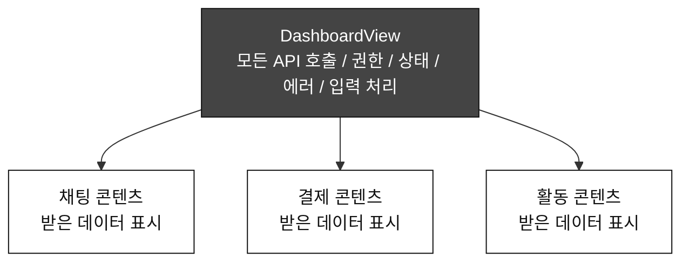

- 하위 뷰를 단순하게 만들면 그 책임은 부모로 올라간다.
    - `DashboardView` 가 각 피처의 API와 권한 의존성을 모두 받는다.
    - 여러 비동기 작업을 실행하고, 결과를 기다리고, 실패를 처리한다.
    - 자식의 사용자 입력도 부모로 올라와 처리된다.

- 이 구조의 UI 계층은 얕지만 부모의 책임은 무겁다.
    - 피처를 추가할 때마다 부모의 프로퍼티와 상태, 처리 분기가 늘어난다.
    - 하위 뷰끼리의 로딩을 묶어 한 피처의 실패가 다른 피처의 표시까지 막기 쉽다.
    - **자식이 단순하다는 사실만으로 전체 설계가 단순해지지는 않는다.**

#### 두 번째 접근 : 각 피처가 자기 일을 맡는다

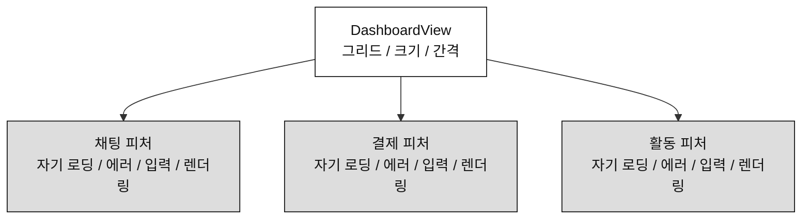

- 각 하위 피처에 필요한 의존성을 연결하고 자기 상태를 처리하게 한다.
    - `DashboardView` 는 피처를 배치하고 화면 크기에 맞는 레이아웃을 만든다.
    - 부모가 자식보다 더 단순해질 수 있다.

- 로딩과 실패의 범위도 피처별로 나뉜다.
    - 채팅 로딩이 실패해도 결제 현황은 표시할 수 있다.
    - 각 피처가 자신의 속도로 로드하고 갱신한다.
    - 기능상 독립된 피처를 하나의 로딩 결과에 불필요하게 묶지 않는다.

#### 세 번째 접근 : 피처 안에서도 렌더링을 나눈다

- 책임을 자식에게 옮겼더니 각 피처가 여전히 크다면 한 번 더 나눈다.
    - [[10. Projects/Mobile System Design/Study-Summaries/UI/05. 자급자족 피처 I|자급자족 피처 I 정리]] 의 로딩 컨테이너와 콘텐츠 분리를 적용한다.
    - 피처 진입점은 상태를 연결하고, 내부 콘텐츠 뷰가 실제 렌더링을 맡는다.

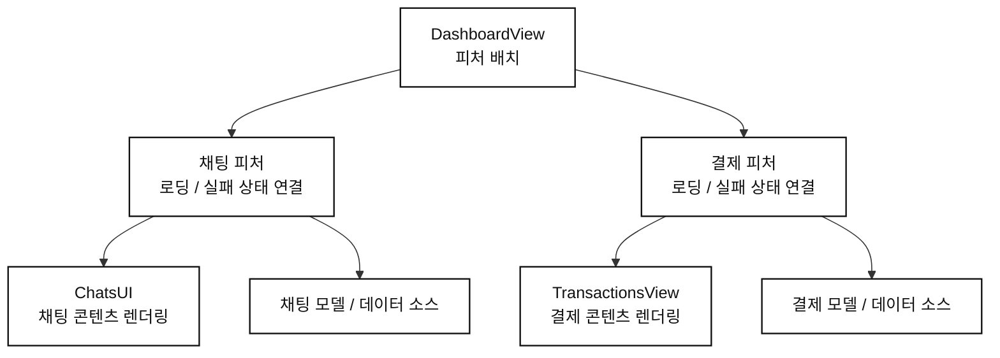

- 이제 UI는 세 단계의 역할로 나뉜다.
    - 대시보드는 배치를 맡는다.
    - 각 피처는 자기 상태와 동작을 UI에 연결한다.
    - 콘텐츠 뷰는 해당 피처의 화면 요소를 렌더링한다.

- 비즈니스 상태와 동기화가 복잡하다면 모델 도메인으로 더 옮길 수 있다.
    - [[10. Projects/Mobile System Design/Study-Summaries/UI/07. 자급자족 피처 III|자급자족 피처 III 정리]] 의 `CourseSession` 과 같은 책임 분리가 이어진다.
    - UI 계층을 나누는 것과 비즈니스 로직을 UI 밖에 두는 것은 함께 적용할 수 있다.

#### 코드로 보면 : 대시보드는 배치할 콘텐츠를 받는다

- 대시보드가 각 피처의 내부 타입까지 알 필요는 없다.
    - 다음 예제는 채팅과 결제를 나란히 놓고, 활동 피처는 한 줄 전체에 배치한다.
    - 각 영역에는 독립적으로 동작하는 피처를 넘긴다.

```kotlin
@Composable
fun DashboardView(
    chats: @Composable () -> Unit,
    payments: @Composable () -> Unit,
    activities: @Composable () -> Unit,
) {
    LazyVerticalGrid(
        columns = GridCells.Fixed(2),
        horizontalArrangement = Arrangement.spacedBy(16.dp),
        verticalArrangement = Arrangement.spacedBy(16.dp),
    ) {
        item(key = "chats") { chats() }
        item(key = "payments") { payments() }
        item(
            key = "activities",
            span = { GridItemSpan(maxLineSpan) },
        ) {
            activities()
        }
    }
}
```

- 피처를 조립하는 쪽에서 각 세션을 해당 뷰에 연결한다.
    - 아래의 피처 뷰는 7장의 `CourseView` 처럼 자기 세션의 상태를 관찰하고 표시하는 뷰라고 가정한다.

```kotlin
DashboardView(
    chats = { ChatsView(session = chatSession) },
    payments = { PaymentsView(session = paymentSession) },
    activities = { ActivitiesView(session = activitySession) },
)
```

- **`DashboardView` 는 피처들의 로딩 완료를 한꺼번에 기다리지 않는다.**
    - 채팅에서 에러가 발생하면 채팅 피처가 그 영역에 표시한다.
    - 결제 피처는 자기 상태에 따라 계속 표시할 수 있다.
    - 배치 코드는 그대로 두고 각 피처의 내부 구현을 바꿀 수 있다.

### 계층을 늘린 대가는 무엇인가

- 타입과 연결 지점이 늘어난다.
    - 코드 파일 하나만 읽고 전체 동작을 볼 수는 없게 된다.
    - 각 타입에 의존성을 전달하는 구조도 필요하다.

- 대신 문제를 좁혀서 볼 수 있다.

| 문제 | 먼저 살펴볼 책임 |
| --- | --- |
| 최근 활동 데이터가 로드되지 않는다 | 활동 피처와 그 모델 / 데이터 소스 |
| 그리드 간격이나 배치가 잘못됐다 | `DashboardView` |
| 채팅 항목의 표시가 잘못됐다 | 채팅 콘텐츠 뷰 |

- 타입을 나누는 이유는 나중에 재사용할지 몰라서가 아니다.
    - 지금 존재하는 복잡성을 한 곳에 몰아두지 않기 위해서다.
    - 역할이 뚜렷해야 버그와 변경의 위치도 좁혀진다.

#### 복잡한 UI 문제를 의존성 문제로 바꾼다

- 최종적으로 `DashboardView` 는 배치할 피처나 그 피처를 만드는 팩토리를 받으면 된다.
    - 각 피처의 API, 저장소, 권한 검사기를 전부 알 필요는 없다.
    - 필요한 시점에 피처를 생성하도록 구성할 수도 있다.

- 이때 부모가 자식의 의존성까지 줄줄이 받아 전달하면 다시 복잡해진다.
    - [[10. Projects/Mobile System Design/Study-Summaries/Fundamentals/08. 제정신을 지키는 의존성 주입 정리|의존성 주입 정리]] 에서 다룬 것처럼, 직접 사용하는 의존성만 알게 만든다.
    - 각 피처를 조립하는 쪽이 내부 의존성을 연결한다.

- **전체 시스템의 복잡성은 남아도, 개별 타입이 한 번에 감당하는 복잡성은 줄어든다.**
    - 이제 고민은 모든 상태를 한 뷰에서 조율하는 일보다, 역할이 나뉜 객체를 어떻게 연결할지에 가까워진다.

### 피처끼리 상호작용해야 한다면

- 피처를 나눴다고 서로 협력할 수 없어야 하는 것은 아니다.
    - 협력이 UI 동작인지 데이터 동작인지에 따라 책임 위치를 정한다.

| 협력의 종류 | 둘 만한 위치 | 이유 |
| --- | --- | --- |
| 피처 사이의 드래그, 대상 강조, 드롭 전달 | `DashboardView` 같은 UI 조합 계층 | 여러 영역을 가로지르는 화면 상호작용이다 |
| 한 모델의 변경을 여러 피처에 반영 | 모델 도메인 | 같은 데이터의 동기화는 대시보드 밖에서도 필요하다 |

#### 드래그 앤 드롭은 부모의 일이 될 수 있다

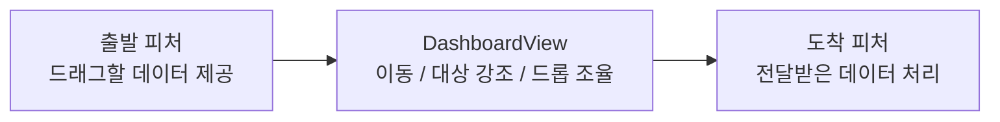

- 부모의 책임이 다시 늘어도 그 역할에 맞는 일이라면 받아들일 수 있다.
    - 여러 피처 위를 가로지르는 드래그는 부모가 전체 배치를 알아야 처리하기 쉽다.
    - 부모를 무조건 가장 단순하게 만드는 것이 목표는 아니다.

#### 데이터 동기화는 모델에서 연결한다

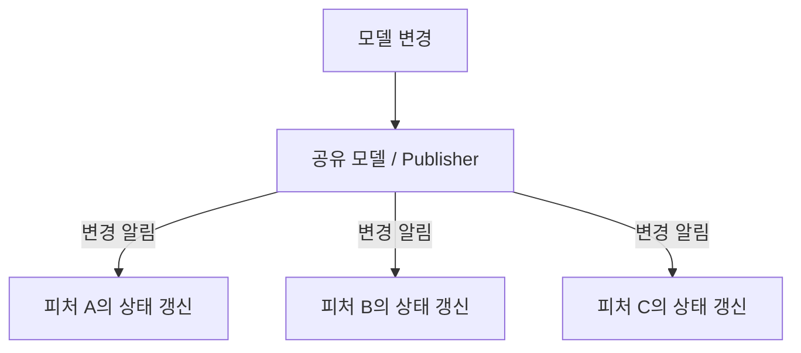

- `Publisher-Subscriber(pub/sub)` 나 리액티브 방식으로 여러 소비자가 같은 모델의 변경을 관찰할 수 있다.
    - 데이터 동기화를 `DashboardView` 에 넣지 않아도 된다.
    - 다른 화면에서도 같은 모델 동작을 사용할 수 있다.
    - UI를 띄우지 않고 변경 전파를 테스트하기 쉬워진다.

### 설정 목록 : 화면이 평평해도 코드는 나눌 수 있다

#### 단순한 행 뒤에 많은 책임이 숨어 있다

- 설정 화면에는 프로필, 보안, 결제, 개인정보, 외부 연동 등이 함께 들어갈 수 있다.
    - 위치 토글 하나에도 권한 확인과 설정 저장이 필요할 수 있다.
    - 결제 설정에는 별도의 API가 필요하다.
    - 외부 연동 항목에는 해당 서비스의 상태와 의존성이 붙는다.

- 모든 행을 `SettingsView` 가 직접 관리하면 의존성도 한곳에 모인다.
    - 사용자, 프로필 설정, 보안 설정, 결제 API, 보안 저장소 등이 늘어난다.
    - 각 행의 비동기 호출과 사용자 입력까지 부모가 처리한다.
    - 겉보기에는 목록 하나지만 내부는 여러 피처를 한 타입에 넣은 구조다.

#### 첫 번째 방법 : 하위 화면으로 나눈다

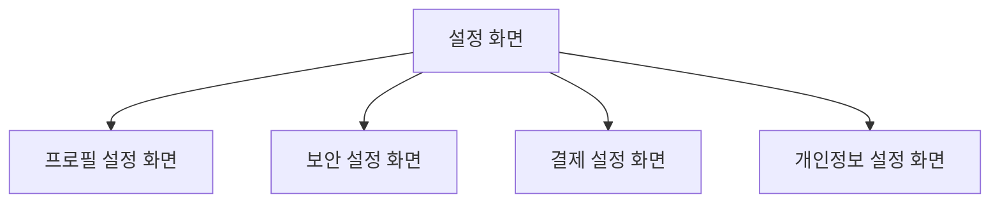

- 메인 설정 화면은 각 범주의 하위 화면으로 이동하는 진입점이 된다.
    - UI와 기능의 계층이 함께 나뉜다.
    - 각 화면은 자기 설정과 의존성만 관리한다.
    - 나머지는 필요한 의존성을 전달하는 문제로 정리할 수 있다.

#### 두 번째 방법 : 화면은 유지하고 섹션을 나눈다

- 제품 요구상 모든 설정을 목록 하나에 보여줘야 할 수도 있다.
    - **화면이 하나라는 이유로 구현 타입도 하나여야 하는 것은 아니다.**
    - `SecuritySection`, `PaymentsSection`, `PrivacySection` 처럼 섹션별 타입을 둔다.

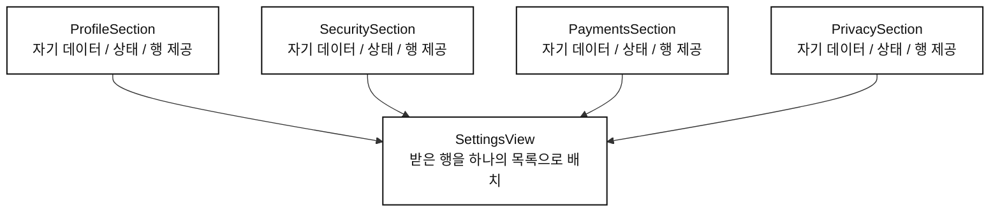

- 각 섹션이 자기 데이터 로딩, 상태, 입력 처리와 행 구성을 맡는다.
    - `SettingsView` 는 섹션이 제공한 행을 받아 하나의 목록으로 렌더링한다.
    - 최종 배치는 부모가 맡지만 각 행을 동작하게 하는 책임은 섹션에 있다.

- Compose에서는 각 섹션이 부모의 `LazyListScope` 에 자기 행을 추가하게 만들 수 있다.
    - `LazyColumn` 은 부모가 하나만 만든다.
    - 섹션은 자기 행의 키, 상태 관찰, 사용자 입력 연결을 맡는다.

- 보안 섹션을 예로 들면 다음과 같다.
    - `SecuritySettings` 는 `lockEnabled: StateFlow<Boolean>` 과 변경을 처리하는 `setLockEnabled(Boolean)` 을 제공한다고 가정한다.
    - 설정의 로딩과 저장은 이 모델의 책임이다.

```kotlin
class SecuritySection(private val settings: SecuritySettings) {
    fun addRows(scope: LazyListScope) {
        scope.item(key = "security:title") {
            Text("보안")
        }

        scope.item(key = "security:app-lock") {
            val enabled by settings.lockEnabled.collectAsStateWithLifecycle()

            Row(
                modifier = Modifier.fillMaxWidth(),
                horizontalArrangement = Arrangement.SpaceBetween,
            ) {
                Text("앱 잠금")
                Switch(
                    checked = enabled,
                    onCheckedChange = settings::setLockEnabled,
                )
            }
        }
    }
}
```

- 부모는 각 섹션에 행을 추가해 달라고 요청한다.
    - 다른 섹션도 같은 방식으로 `addRows` 를 제공한다.

```kotlin
@Composable
fun SettingsView(
    profileSection: ProfileSection,
    securitySection: SecuritySection,
    paymentsSection: PaymentsSection,
    privacySection: PrivacySection,
    integrationSection: IntegrationSection,
    communitySection: CommunitySection,
) {
    LazyColumn {
        profileSection.addRows(this)
        securitySection.addRows(this)
        paymentsSection.addRows(this)
        privacySection.addRows(this)
        integrationSection.addRows(this)
        communitySection.addRows(this)
    }
}
```

- `addRows` 는 행을 등록하고, 실제 Compose 호출은 `item` 의 콘텐츠 안에서 실행한다.
    - 섹션마다 별도의 세로 목록을 중첩하지 않으므로 하나의 스크롤 흐름을 유지한다.
    - 모든 행이 같은 목록에 들어가므로 `security:app-lock` 처럼 섹션을 포함한 키로 충돌을 피한다.

- `SettingsView` 가 `PaymentsAPI` 나 `SecureStore` 까지 알 필요는 없다.
    - 그런 의존성은 해당 섹션을 만드는 쪽에서 연결한다.
    - 섹션의 행이 어떻게 최신 상태를 유지하는지도 부모는 몰라도 된다.

- 이 방식은 기능의 소유권과 최종 렌더링 위치를 분리한다.
    - 각 섹션은 독립적으로 동작한다.
    - 사용자는 여전히 하나의 일관된 목록을 본다.

#### 섹션도 복잡하면 행을 추출한다

- 특정 행이 권한, 위치, 저장소, 외부 의존성까지 다룬다면 별도 타입으로 나눌 수 있다.
    - 섹션을 나눌 때와 같은 원리다.
    - 다만 타입과 연결 비용도 늘어난다.

- 모든 행을 미리 타입으로 만들 필요는 없다.
    - **실제로 이해하고 관리하기 어려운 책임이 모였을 때 더 나눈다.**
    - 계층의 깊이 자체가 설계의 목표는 아니다.

### 정리

| 사례 | 부모가 맡는 것 | 하위 피처가 맡는 것 |
| --- | --- | --- |
| 페이지네이션 | 스크롤, 메뉴, 페이지 배치 | 각 코스의 로딩과 상태 처리 |
| 대시보드 | 그리드와 피처 간 UI 상호작용 | 각 피처의 데이터와 실패 처리 |
| 하나의 설정 목록 | 섹션이 제공한 행의 통합 렌더링 | 자기 데이터, 상태, 행의 동작 |

- 피처와 화면을 구분하면 같은 피처를 전체 화면으로도, 화면의 일부로도 쓸 수 있다.
- 자급자족 피처를 조합하면 부모가 모든 상태와 실패를 관리하지 않아도 된다.
- 계층을 추가하는 이유는 현재의 복잡성을 책임별로 나누기 위해서다.
- 시각적으로 평평한 UI도 섹션과 모델에는 계층을 둘 수 있다.

> 화면 모양이 코드의 책임 구조까지 결정하게 두지 않는다.

---
