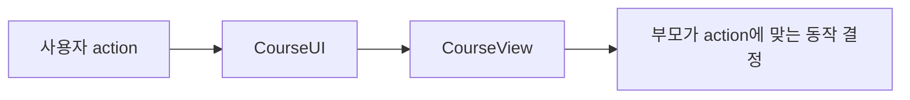
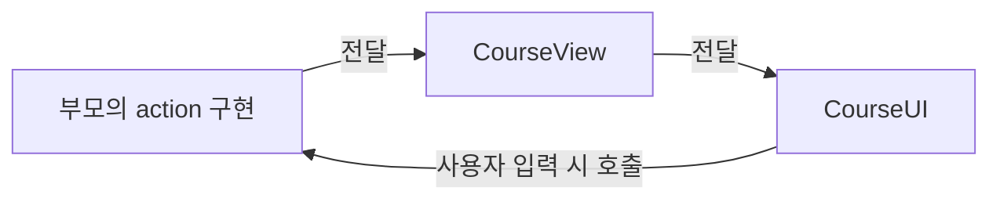
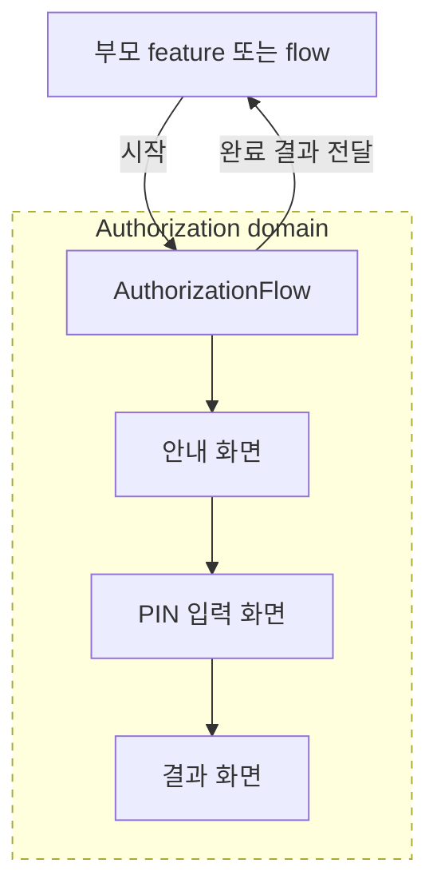
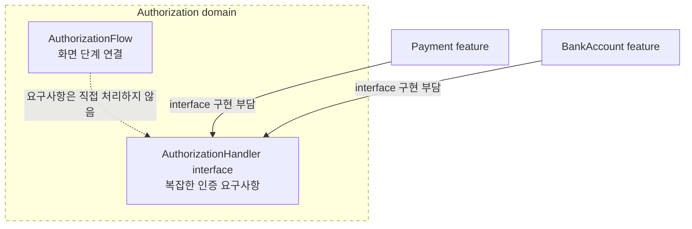
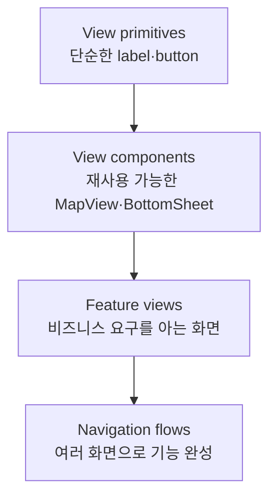
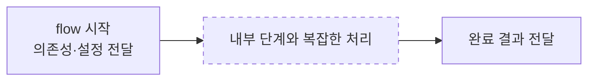

# [WEEK 21] Book 1 Chapters 9–10
📖 Mobile System Design 1. UI Frameworks, Architectures, and Supporting Multiple Products  

 

## 9. Reusing Views Across Flows
view가 어떤 flow에 놓일지 몰라도 동작하게 만들면 여러 flow에서 재사용하기 쉽다. view는 사용자가 한 행동을 알리고 navigation은 부모가 결정한다.  

### Common problems
닫기 동작은 화면을 띄운 방식에 따라 다르다. 모달은 닫고 navigation stack(화면 이동 순서를 관리하는 목록)에 쌓인 화면은 목록에서 제거해야 한다. 
view가 열린 방식을 판단해 직접 닫으면 부모가 기록한 화면 순서와 실제 화면이 달라질 수 있다. 부모는 화면이 아직 목록에 있다고 생각하는데 view가 먼저 제거하는 경우가 그렇다. 
view를 다른 화면 안에 넣으면 자체 stack이 없을 수도 있다. 이때는 닫기 버튼을 감추거나 부모가 view를 없애도록 action을 전달해야 한다.  

#### A smarter, yet still problematic, approach
navigation stack을 직접 바꾸는 대신 `Coordinator`에 navigation을 맡길 수 있다. 하지만 view가 특정 `Coordinator`를 받아야 한다는 전제는 남는다.  

> [!Note]
> `Coordinator`는 flow의 navigation 상태를 관리하고 화면 간 이동을 연결하는 type이다.  

#### The view decides what the parent should be
interface를 사용해도 부모는 `Coordinator`가 정의한 navigation method를 구현해야 한다. 즉 view가 부모에게 coordinator 역할을 요구하는 구조는 그대로다.  

#### The child orders a parent around
view가 `openSettings()`를 직접 호출하면 특정 버튼을 눌렀을 때 부모가 무엇을 해야 하는지도 view가 정하게 된다. 다른 flow에서는 같은 버튼이 권한 화면을 열거나 아무 동작도 하지 않을 수 있다.  

---

### Preparing for a solution
`CourseUI`가 navigation method를 직접 부르는 대신 버튼을 누른 사실만 `CourseView`와 부모에게 전달하도록 바꾼다.  

#### What we need to support
`joinCall()`이나 `openScheduler()`처럼 결과 동작을 정하는 이름 대신 `didPressJoinCall()`이나 `didPressSchedule()`처럼 사용자가 한 행동을 나타내도록 이름을 바꾼다. 그러면 부모가 action에 맞는 동작을 직접 선택할 수 있다.  

---

### Considering various solutions
Closure, action interface, declarative API 등 여러 방식으로 action을 전달할 수 있다. 구현 방식이 달라도 view가 navigation을 모르고 부모가 action을 결정해야 한다는 원칙은 같다.  

---

### Using closures
버튼을 누르면 `CourseUI`가 전달받은 closure를 호출한다. 이 closure는 `CourseView`를 거쳐 부모가 연결한 동작을 실행한다. 부모는 coordinator일 수도 있고 다른 view나 flow일 수도 있다.  

> [!Note]
> 이 장의 closure는 호출할 동작을 값처럼 전달하는 방식이다. Kotlin에서는 람다를 전달하는 것과 비슷하다.  

---

### A closure implementation
부모에서 전달한 closure를 `CourseView`가 받아 `CourseUI`까지 연결한다. 중간 view는 action을 전달할 뿐 navigation을 직접 수행하지 않는다.  

#### When a parent is a coordinator
부모가 coordinator라면 버튼 action을 coordinator의 navigation method에 연결한다. 부모는 coordinator가 아니어도 되며 같은 view를 embed하는 다른 view가 action을 다르게 처리할 수도 있다.  

#### Cleaning up the call-site
부모의 method를 closure 안에서 다시 호출하지 말고 method 자체를 전달하면 감싸는 코드 한 겹을 줄일 수 있다.  

#### Gluing everything together
부모의 method를 `CourseView`에 action으로 전달한다. `CourseView`가 이를 `CourseUI`에 넘기면 버튼을 눌렀을 때 부모의 method가 호출된다.  

#### Inside CourseView
`CourseView`는 action closure를 입력으로 받고 `CourseUI`에 전달한다. `CourseView`는 action의 실제 결과를 알 필요가 없다.  

#### Inside CourseUI
`CourseUI`는 버튼 입력에 연결된 closure를 호출한다. closure가 어떤 화면 이동이나 동작으로 이어지는지는 부모가 정한다.  

#### Cleaning up CourseUI
closure만 다시 호출하는 중간 method는 없앨 수 있다. 그러면 action이 버튼에서 부모까지 전달되는 흐름을 따라가기 쉬워진다.  

#### Trade-offs when using closures
action이 적고 view가 얕게 중첩된 경우 closure가 간단하다. action 수나 중첩 깊이가 늘면 각 단계에서 전달할 closure도 늘어나 설정 코드가 복잡해진다.  

---

### Passing a navigation type
action이 많아지면 여러 closure 대신 action을 모은 type 하나를 전달할 수 있다. 다만 type의 이름과 method가 navigation을 전제하면 view가 flow에 결합되는 문제가 다시 생긴다.  

#### A navigation interface
`CourseCoordinator` 같은 interface를 정의하면 `CourseView`에는 해당 interface를 구현하는 type만 전달하면 된다. action을 추가할 때 여러 view의 initializer를 수정할 필요가 줄어든다.  

#### The problem of passing a navigation type
interface를 사용해도 view가 coordinator를 요구한다는 전제는 남는다. `CourseUI`가 `openScheduler()`처럼 navigation method를 호출하면 view가 navigation에 직접 연결된다.  

#### The name sets expectations
type을 `CourseActions`처럼 action 중심으로 이름 짓고 method도 `didPressSchedule()`처럼 사용자 행동을 나타내도록 한다. 부모는 같은 action을 navigation 외의 동작에도 연결할 수 있다.  

| view가 알리는 action | 부모가 고르는 동작 |
| --- | --- |
| `didPressSchedule()` | `openScheduler()` |
| `didPressJoinCall()` | `openCallFlow()` 또는 경고 표시 |

---

### Dealing with optionality
view를 다른 flow에서 재사용하면 일부 버튼이나 action이 필요하지 않을 수 있다. declarative API는 필요한 action만 설정하게 해 view 구성을 유연하게 한다.  

#### Designing a declarative solution
initializer에 모든 action을 한꺼번에 넘기는 대신 `.didPressSchedule(action:)`처럼 설정 method를 이어 호출할 수 있다.  

#### Reasoning about optionality
action을 optional로 만들면 필요한 action만 구현할 수 있지만 컴파일러가 빠진 action을 알려주지 않는다. 설정의 편리함과 컴파일 시점의 누락 검사를 맞바꾸는 셈이다.  

action이 설정되지 않았을 때는 다음처럼 처리할 수 있다.

- 관련 버튼을 표시하지 않는다.
- 기본 동작을 실행한다.
- 개발 중 경고를 출력하거나 assertion을 발생시킨다.

#### Embracing optionality
action을 하나도 설정하지 않은 기본 view도 사용할 수 있어야 한다. action을 하나씩 추가하는 중간 상태에서도 view가 정상적으로 표시되어야 한다.  

---

### Implementing a declarative API
책의 SwiftUI 구현은 설정 method가 action을 보관한 새 `CourseView` 값을 반환하게 한다. 따라서 설정을 이어 붙일 수 있지만 action을 선택적으로 보관하고 `CourseUI`까지 전달하는 구현이 필요하다.  

#### Gluing actions to new instances
SwiftUI view는 값 type이므로 method 안에서 현재 값을 복사하고 새 action을 설정한 뒤 복사본을 반환한다. 저장되는 closure에는 Swift의 `@escaping` 규칙도 적용된다.  

#### Implementing all declarative methods
각 action마다 값을 복사하고 해당 action을 설정해 반환하는 method를 만든다. 반복되는 구현 코드가 생길 수 있다.  

#### Connecting to CourseUI
`CourseView`는 optional action을 `CourseUI`에 전달한다. 설정되지 않은 action에 해당하는 버튼은 `CourseUI`에서 생략할 수 있다.  

#### Chaining forever
설정 method가 계속 `CourseView`를 반환하므로 여러 설정을 연결할 수 있다. 같은 action을 여러 번 설정할 때 마지막 값만 쓸지 모두 실행할지는 API가 정해야 한다.  

Compose에서는 nullable callback을 받고 callback이 없으면 해당 버튼을 그리지 않는 식으로 action을 선택적으로 만들 수 있다. SwiftUI의 값 복사 방식을 그대로 적용할 필요는 없다.  

---

### Conclusion
view는 "사용자가 일정 버튼을 눌렀다"는 사실까지만 전달하고 다음 화면을 열지 다른 동작을 할지는 부모가 정한다. Closure와 action type은 action 전달 방식의 선택지다. Declarative API는 필요한 action만 설정할 수 있지만 구현과 누락 관리는 더 복잡해진다.  

---

### What we covered
- view는 navigation stack을 직접 바꾸지 않고 사용자가 한 action을 전달한다.
- action 이름은 부모가 할 일이 아니라 사용자가 한 일을 나타낸다.
- Closure는 작은 규모에서 간단하지만 action 수와 view 중첩이 늘면 전달 코드가 많아진다.
- 별도 type을 쓸 때도 navigation보다 action을 드러내는 이름을 사용한다.
- Optional action은 재사용성을 높이지만 누락을 컴파일 시점에 확인하기 어렵다.
- declarative API는 각 설정 단계가 유효한 view를 반환해야 한다.

 

## 10. Crafting Robust and Reusable Navigation Flows
navigation flow는 여러 화면을 이어 하나의 기능을 완성한다. 부모는 flow를 시작하고 완료 결과를 받으며 화면 전환과 중간 처리는 flow가 맡는다.  

### An authorization flow
Authorization flow는 결제나 계좌 등록처럼 서로 다른 기능에서 재사용할 수 있다. 화면 문구는 사용 목적에 맞게 바꿀 수 있으며 인증 수단도 달라질 수 있다.  

#### A flow is born
`AuthorizationFlow`는 안내, PIN 입력, 결과 화면을 순서대로 연결한다. 각 view는 자신의 단계가 끝났다고 알리고 다음 단계는 flow가 결정한다.  

#### Defining the Authorization domain
`AuthorizationFlow`는 Authorization domain에 속하며 필요하면 별도 모듈이 될 수 있다. 부모가 flow를 시작하고 완료 결과를 받지만 flow는 부모가 누구인지 알 필요가 없다.  

---

### Gathering requirements: deceptively complex
화면은 세 단계뿐이어도 token 만료나 PIN 반복 입력처럼 UI에 드러나지 않는 상황이 많다. 화면부터 만들기보다 flow가 처리해야 할 인증과 session, 역할별 동작, 설정을 먼저 확인한다.  

#### List of requirements
요구사항에는 다음이 포함된다.

- token 만료와 폐기, 갱신 및 flow 도중 로그아웃 대응
- PIN 입력 횟수 제한과 반복 실패 시 잠금
- 의심 행동 탐지와 필요 시 로그아웃
- 학생과 tutor별로 다른 endpoint 사용
- 첫 화면과 완료 화면의 문구 변경
- 향후 인증 방식을 지원하기 위한 API version 관리

#### First attempt at handling complexities
첫 설계는 `AuthorizationHandler` interface에 인증 성공·실패, token 폐기, 입력 제한, timeout, 화면 문구 등을 처리할 method를 모은다. 화면 단계를 연결하는 일과 인증 처리를 분리하려는 방식이다.  

---

### Reviewing the current design
`AuthorizationHandler`에 method만 나열하고 실제 처리를 부모에게 맡기면 각 부모 feature가 인증 세부사항을 직접 구현해야 한다. 결제와 계좌 등록 flow가 token이나 입력 횟수 제한을 각각 처리하는 식이다. 그러면 `AuthorizationFlow`는 화면만 넘기고 인증 로직은 사용하는 곳마다 반복된다.  

---

### Why do we need navigation flows, anyway?
view는 단순한 UI 조각부터 비즈니스 로직을 아는 화면까지 여러 수준으로 나뉜다. navigation flow는 화면들을 연결해 하나의 feature를 완성한다.  

#### The role of views
view는 단순한 primitive부터 비즈니스 요구를 아는 feature view까지 역할이 다르다.  

#### Views rarely are features
영상 녹화 화면 하나만으로 영상 기능이 완성되지는 않는다. 영상 feature에는 편집과 삭제, 재생, 공유 같은 과정도 포함될 수 있다. 단일 목적의 화면 하나가 feature 전체를 맡는 경우는 드물다.  

#### Views in flows
휴대폰에서는 화면을 채우고 tablet에서는 배정된 container를 채우는 view가 flow의 한 단계가 될 수 있다. 여기서 `screen`은 view가 차지하는 영역을 뜻할 뿐 추상화 수준을 뜻하지 않는다.  

#### Navigation flows are often features
결제처럼 여러 화면을 거쳐 완성되는 기능은 하나의 flow로 묶는다. 그래서 flow는 개별 view보다 높은 수준에서 전체 feature를 나타내는 경우가 많다.  

---

### A navigation flow is like a story
flow는 시작과 진행 과정, 끝으로 이루어진 이야기처럼 볼 수 있다. 부모는 시작을 요청하고 완료 결과를 받으며 내부 진행 방식은 flow가 맡는다.  

#### Many flows can be reduced to a story
복잡한 image picker도 부모 입장에서는 시작한 뒤 사용자가 고른 image를 받는 기능이다. flow가 성공 여부만 알려준다면 결과는 boolean일 수도 있다.  

#### Purpose matters; the rest is extra
부모에게 중요한 것은 flow의 내부 화면 수나 animation이 아니라 목적을 달성했는지와 그 결과이다. 먼저 목적과 반환값을 API로 드러내고 나머지 구현은 flow 안에 둔다.  

---

### Designing the API
`AuthorizationFlow`는 시작할 수 있고 인증이 끝나면 결과를 전달하는 API부터 설계한다. 결과는 성공 여부만 담을 수도 있고 실패 원인을 포함할 수도 있다.  

Android/Compose에서도 부모가 flow를 시작하고 완료 결과를 받는 API를 둘 수 있다. 화면을 표시하는 구체적인 방식은 사용하는 navigation 구조에 따라 달라진다.  

#### Re-adding complexities
복잡한 인증 처리를 부모 feature에 맡기지 않는다. 필요하면 Authorization domain 안의 type에 나누어 맡기고 `AuthorizationFlow`가 이를 연결한다.  

#### Defining internal types
요구사항에 따라 `RateLimiter`, `SecureStorage`, `TokensSDK` 같은 내부 type을 둘 수 있다. 특정 flow에만 필요하지 않은 `PinpadView`는 UI Library처럼 더 알맞은 domain으로 옮길 수도 있다.  

#### Adding dependencies
flow가 동작하는 데 필요한 dependency만 API에 추가한다. `User`와 `Network`처럼 필수 입력부터 전달하고 사용하지 않는 dependency까지 한꺼번에 공개하지 않는다.  

#### Adding configurations
안내와 완료 문구처럼 달라질 설정을 API로 받으며 문구는 localization도 고려한다. 설정이 많아지면 `Config` type으로 묶어 initializer가 계속 커지지 않게 할 수 있다.  

---

### Reducing a flow to its purest form
부모는 flow를 시작할 때 필요한 의존성과 설정을 전달하고 끝난 뒤 결과를 받는다. 중간 화면과 복잡한 처리는 flow 안에 둔다. flow가 한 화면에서 여러 단계로 바뀌어도 부모가 사용하는 시작·완료 API는 유지할 수 있다.  

---

### What we covered
- flow는 여러 화면을 묶어 하나의 feature를 완성하는 경우가 많다.
- 개별 view는 flow의 단계가 될 수 있지만 view 하나가 전체 feature인 경우는 드물다.
- flow API는 시작과 완료 결과를 중심으로 설계한다.
- 내부 복잡도는 flow domain 안에서 처리하고 부모에는 필요한 의존성과 설정만 공개한다.
- 설정이 늘면 `Config` type으로 묶어 API가 불필요하게 커지는 것을 막는다.
