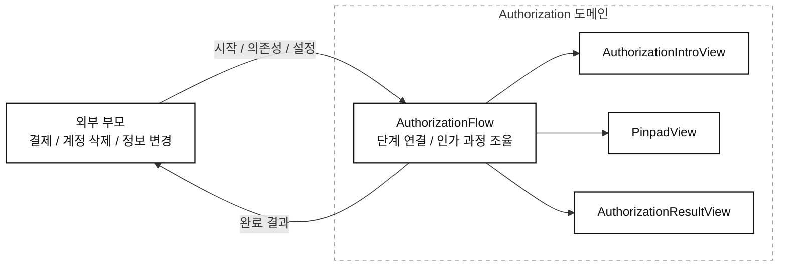
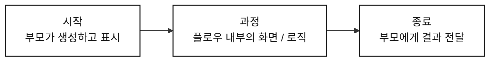

```table-of-contents
```

## 9장 [[10. Projects/Mobile System Design/StudyVault/UI-09-Reusing-Views-Across-Flows/09. 플로우 전반에서 뷰 재사용하기|플로우 전반에서 뷰 재사용하기]]

> 뷰는 사용자가 무엇을 했는지 알린다. 그다음 어디로 갈지는 부모가 정한다.

- **뷰를 여러 플로우에서 재사용하려면, 자신이 어디에 배치됐는지와 다음에 무엇을 열어야 하는지를 몰라도 동작해야 한다.**
    - 같은 뷰를 스택에 넣거나, 모달로 띄우거나, 더 큰 화면의 일부로 넣을 수 있다.
    - 뷰의 표시 방식과 다음 이동은 그 뷰를 배치한 부모가 결정한다.

- [[10. Projects/Mobile System Design/Study-Summaries/UI/05. 자급자족 피처 I|5장]] 에서는 피처가 자기 로딩과 에러를 감당하도록 만들었다.
    - 그렇다고 자신을 둘러싼 내비게이션까지 직접 관리해야 하는 것은 아니다.
    - **자기 일을 처리하는 것과 부모의 일을 대신 결정하는 것은 다르다.**

- 이번 장은 내비게이션 프레임워크를 고르는 장이 아니다.
    - 기존 `CourseView` 와 `CourseUI` 를 어떤 플로우에서도 쓰기 쉽게 만드는 장이다.
    - 콜백, 인터페이스, 선택 가능한 액션을 제공하는 선언형 API를 비교한다.

### 뷰가 내비게이션을 알면 생기는 문제

#### 자기가 알아서 닫는 뷰

- 닫기 버튼을 누르면 자신의 표시 방식을 확인해 `dismiss` 또는 `pop` 하는 뷰가 있다고 하자.
    - 모달이면 모달을 닫는다.
    - 스택에 들어 있으면 스택에서 자신을 뺀다.
    - 처음에는 부모의 부담을 덜어주는 것처럼 보인다.

- 하지만 부모가 관리하던 내비게이션 상태를 자식도 바꾸게 된다.
    - 각 뷰가 스택을 바꾸면 누가 전체 흐름을 책임지는지 불분명해진다.
    - 부모가 추적하는 상태와 실제 표시 상태가 어긋날 수 있다.

- 뷰를 다른 화면 안에 넣으면 기존 가정이 더 쉽게 깨진다.
    - 닫기 버튼이 없어야 할 수도 있다.
    - 버튼을 누르면 그 영역만 숨겨야 할 수도 있다.
    - **닫기 버튼을 눌렀다는 사실만으로 스택을 변경해야 한다고 결정할 수는 없다.**

#### 코디네이터를 전달하면 해결되는가?

- 뷰가 스택을 직접 다루지 않고 `coordinator.openSettings()` 를 호출하게 바꿀 수 있다.
    - 실제 이동은 코디네이터가 수행한다.
    - 하지만 뷰에는 여전히 두 가지 가정이 남는다.

| 남아 있는 가정 | 다른 플로우에서 생기는 문제 |
| --- | --- |
| 부모가 코디네이터를 제공한다 | 라우터나 단순한 메소드로 연결하는 부모도 코디네이터에 맞춰야 한다 |
| 버튼을 누르면 설정 화면을 연다 | 온보딩에서는 권한 안내를 열거나 버튼을 숨겨야 할 수 있다 |

- 코디네이터를 인터페이스로 바꿔도 `openSettings()` 라는 계약은 그대로다.
    - 구현을 바꿀 수는 있지만, 뷰가 특정 이동을 요청한다는 가정은 남는다.
    - 실제로는 다른 동작을 하면서 메소드 이름만 설정 열기로 유지하는 구조가 될 수 있다.

### 이동 명령을 사용자 행동으로 바꾼다

- 먼저 뷰가 내보내는 액션의 이름을 바꾼다.
    - 어디로 이동할지를 표현하던 이름에서, 사용자가 무엇을 했는지를 표현하는 이름으로 내린다.
    - 단순한 이름 변경으로 끝내지 않고, 이동을 결정하는 구현도 부모에 둔다.

| 기존 이름 | 바꾼 이름 | 부모가 결정하는 것 |
| --- | --- | --- |
| `joinCall()` | `didPressJoinCall()` | 통화 플로우를 열지, 먼저 안내를 보여줄지 |
| `openScheduler()` | `didPressSchedule()` | 어떤 일정 변경 과정을 시작할지 |
| `openMessageInbox()` | `didPressMessageButton()` | 채팅을 열지, 다른 메시지 화면을 열지 |
| `openDetails(todoItem)` | `didPressTodoItem(todoItem)` | 선택한 항목으로 무엇을 할지 |

- 같은 원리로 `dismissView()` 대신 `didPressCloseButton()` 을 전달할 수 있다.
    - 뷰는 버튼 입력을 알린다.
    - 부모는 그 입력을 현재 플로우의 의미로 해석한다.
    - **뷰의 액션은 낮은 수준의 사용자 행동이고, 부모의 메소드는 그 행동에 대한 높은 수준의 결정이다.**

### 방법 1 : 콜백을 전달한다


- 연결할 때는 부모가 콜백을 아래로 전달한다.
    - 부모가 `CourseView` 에 전달한다.
    - `CourseView` 가 내부의 `CourseUI` 에 전달한다.
    - 사용자가 버튼을 누르면 그 콜백이 실행된다.

- 부모가 코디네이터라면 다음처럼 연결할 수 있다.
    - 원문의 연결 구조를 Kotlin으로 옮긴 부분 코드다.
    - `CourseView` 의 로딩과 렌더링 구현은 앞 장의 구조를 유지한다.

```kotlin
val courseView = CourseView(
    courseService = courseService,
    id = id,
    didPressJoinCall = coordinator::openJoinCall,
    didPressSchedule = coordinator::openScheduler,
    didPressMessageButton = coordinator::openMessageInbox,
    didPressTodoItem = coordinator::openTodoItemDetails,
)
```

- `CourseView` 는 전달받은 함수만 알면 된다.
    - 그 함수가 코디네이터의 메소드인지, 라우터를 호출하는 람다인지 몰라도 된다.
    - 부모와 자식이 같은 메소드 이름을 쓸 필요도 없다.
    - `didPressMessageButton` 을 `openMessageInbox` 에 연결하는 지점에서 사용자 행동에 플로우의 의미가 붙는다.

- 중간 메소드가 콜백을 호출하는 일만 한다면 직접 전달할 수 있다.
    - `{ coordinator.openScheduler() }` 대신 `coordinator::openScheduler` 를 전달한다.
    - `CourseUI` 도 전달받은 액션을 하위 뷰에 그대로 연결할 수 있다.
    - 중간에서 별도 처리가 필요하다면 그 메소드는 유지한다.

#### 콜백의 한계

- 액션이 적으면 함수 몇 개를 전달하는 방식이 단순하다.
    - 별도 인터페이스 없이 시작할 수 있다.
    - 부모도 필요한 동작만 연결하면 된다.

- 액션 수와 전달 단계가 늘면 연결 코드도 늘어난다.
    - 액션 네 개를 두 단계에서 전달하면 여덟 개의 전달 지점이 생긴다.
    - 한 단계가 더 생기면 열두 개가 된다.
    - 중간 뷰는 직접 쓰지 않는 액션까지 계속 받아 넘겨야 할 수 있다.

- 액션 네 개부터 반드시 인터페이스로 바꿔야 한다는 규칙은 아니다.
    - 현재의 액션 수와 중첩 깊이에서 연결 비용이 얼마나 큰지 보고 판단한다.

### 방법 2 : 액션 인터페이스를 전달한다

- 관련 액션을 인터페이스 하나로 묶으면 중간 뷰가 전달할 값은 하나가 된다.
    - 새 액션을 추가할 때 인터페이스와 구현을 바꾼다.
    - 중간 뷰마다 생성자 매개변수를 하나씩 더 늘릴 필요가 줄어든다.

```kotlin
interface CourseActions {
    fun didPressJoinCall()
    fun didPressSchedule()
    fun didPressMessageButton()
    fun didPressTodoItem(todoItem: TodoItem)
}
```

- 여기서 중요한 것은 인터페이스의 이름과 메소드가 모두 사용자 행동을 표현한다는 점이다.
    - `CourseCoordinator` 에 `openScheduler()` 를 두면 내비게이션을 안다는 가정이 남는다.
    - `CourseActions` 에 `didPressSchedule()` 을 두면 부모가 반응을 결정할 수 있다.
    - **인터페이스로 감싸는 것만으로 책임이 분리되지는 않는다.**

- 부모는 이 계약을 직접 구현하거나 별도 객체로 연결할 수 있다.
    - `CourseView` 와 `CourseUI` 는 구체적인 부모를 몰라도 된다.
    - 다만 인터페이스에 필수로 선언한 액션은 구현해야 한다.
    - 특정 플로우에서는 필요 없는 액션을 어떻게 다룰지도 따로 생각해야 한다.

### 방법 3 : 필요한 액션만 설정한다

#### 선택 가능한 액션이 필요한 이유

- 다른 플로우에서는 일부 버튼만 필요할 수 있다.
    - 통화는 허용하되 일정 변경은 제공하지 않을 수 있다.
    - 메시지 버튼이 없는 코스 요약 영역을 만들 수도 있다.

- 원문은 생성자에 모든 액션을 전달하는 대신, 액션을 하나씩 붙이는 선언형 API를 제안한다.
    - 아래는 SwiftUI의 원문 API다.
    - 기본 뷰와 액션을 추가한 뷰가 모두 유효한 상태여야 한다.

```swift
CourseView(courseService: courseService, id: id)
    .didPressJoinCall(action: openCallFlow)
    .didPressSchedule(action: openCalendarSchedule)
```

- 체이닝은 API를 표현하는 한 방법이다.
    - 실제로 액션을 생략할 수 있는 이유는 내부 액션이 옵셔널이기 때문이다.
    - Kotlin에서도 기본값이 `null` 인 함수 매개변수로 선택 가능한 액션을 표현할 수 있다.
    - Compose에 적용할 때 SwiftUI의 뷰 복사 구조까지 그대로 옮길 필요는 없다.

#### 액션을 설정하지 않으면 어떻게 할 것인가?

| 처리 방식 | 의미와 주의점 |
| --- | --- |
| 해당 UI를 숨긴다 | 그 액션이 없는 뷰도 정상적인 변형으로 인정한다 |
| 기본 동작을 제공한다 | 부모가 설정하지 않아도 정해진 동작을 수행하므로 기본 정책을 분명히 해야 한다 |
| 디버그 메시지를 남긴다 | 개발 중 연결 누락을 알릴 수 있지만 실제 사용자 경험도 따로 정해야 한다 |
| 디버그에서 어설션을 발생시킨다 | 누락을 드러내지만 액션 생략이 유효한 사용인지와 충돌할 수 있다 |

- 책에서는 선택 가능한 액션을 제공했다면 그 선택을 받아들이는 편을 권한다.
    - 액션이 없으면 관련 UI를 생략하는 식이다.
    - 액션을 모두 설정해야만 정상 동작한다면 필수 매개변수로 요구하는 편이 더 명확하다.

- 기본값 없이 필수 콜백을 받으면 누락을 컴파일 시점에 확인할 수 있다.
    - 옵셔널 액션으로 바꾸면 일부 연결을 잊어도 컴파일러가 알려주지 않는다.
    - **설정의 유연성을 얻는 대신, 생략의 의미와 누락을 확인하는 방법을 설계해야 한다.**

#### 선언형 API 내부에서 하는 일

- 원문의 SwiftUI 뷰는 값 타입인 `struct` 다.
    - 설정 메소드는 `self` 를 복사한다.
    - 복사본에 액션을 저장한다.
    - 같은 타입의 복사본을 반환해 다음 메소드 호출을 이어 간다.

```swift
func didPressJoinCall(action: @escaping () -> Void) -> CourseView {
    var copy = self
    copy.didPressJoinCall = action
    return copy
}
```

- 저장한 액션은 이후에 실행되므로 `@escaping` 으로 받는다.
    - 선택 가능한 액션 속성은 `(() -> Void)?` 형태다.
    - `CourseView` 는 이를 `CourseUI` 에 넘기고, `CourseUI` 는 액션 유무에 맞춰 UI를 구성한다.
    - 내부 구현인 `CourseUI` 까지 같은 체이닝 API를 공개할 필요는 없다.

- 같은 설정 메소드를 반복 호출했을 때의 의미도 정해야 한다.
    - 위처럼 속성에 대입하는 구현에서는 마지막 액션이 앞선 액션을 덮어쓴다.
    - 여러 액션을 모두 실행하거나 중복 설정을 막고 싶다면 별도 구현이 필요하다.

### 정리

| 방법 | 잘 맞는 상황 | 감당할 비용 |
| --- | --- | --- |
| 개별 콜백 | 액션이 적고 전달 단계가 얕다 | 액션과 중첩이 늘면 연결 코드가 늘어난다 |
| 액션 인터페이스 | 관련 액션을 묶어 전달한다 | 계약의 크기와 필수 액션의 범위를 관리해야 한다 |
| 선택 가능한 액션과 선언형 API | 플로우마다 제공할 동작이 다르다 | 생략의 의미와 연결 누락을 다뤄야 한다 |

- 세 방법은 순서대로 갈아타야 하는 발전 단계가 아니다.
    - 현재 필요한 액션과 설정 범위에 맞춰 고를 수 있다.
    - 어느 방법이든 뷰가 이동할 목적지를 가정하지 않는다는 기준은 같다.

- 다음 [[10. Projects/Mobile System Design/Study-Summaries/UI/10. 내비게이션 플로우|10장]] 에서는 전달받은 행동으로 전체 과정을 구성하는 부모 플로우를 다룬다.

> 뷰가 사용자 행동만 전달하면, 같은 뷰의 다음 동작을 플로우마다 다르게 정할 수 있다.

---

## 10장 [[10. Projects/Mobile System Design/StudyVault/UI-10-Navigation-Flows/10. 내비게이션 플로우|내비게이션 플로우]]

> 부모는 플로우를 시작하고 결과를 받는다. 그 사이의 복잡성은 플로우의 도메인이 감당한다.

- **내비게이션 플로우는 여러 단계와 그 사이의 로직을 묶어, 사용자가 하나의 과업을 끝내도록 이끄는 단위다.**
    - 단순히 다음 화면을 띄우는 코드만 뜻하지 않는다.
    - 결제, 온보딩, 인가처럼 여러 화면에 걸친 피처 전체를 표현할 수 있다.

- [[10. Projects/Mobile System Design/Study-Summaries/UI/09. 플로우 전반에서 뷰 재사용하기|9장]] 에서는 뷰가 사용자 행동을 전달하고, 부모가 이동을 결정하도록 나눴다.
    - 이번에는 그 부모인 플로우를 다시 다른 부모가 사용할 수 있게 만든다.
    - 플로우도 자신을 시작한 부모의 구체적인 사정을 몰라야 다른 맥락에서 재사용하기 쉽다.

- 책에서는 `AuthorizationFlow` 를 예로 든다.
    - 로그인한 사용자가 결제나 계정 삭제 같은 중요한 작업을 승인하도록 확인하는 인가 플로우다.
    - 예제는 핀 입력을 사용하지만, 이 장의 초점은 인증 수단이 아니라 플로우의 책임과 공개 API다.

### 화면 하나와 피처 전체는 다르다

- [[10. Projects/Mobile System Design/Study-Summaries/UI/03. 뷰, 컴포넌트, 스크린|3장]] 에서는 뷰를 프리미티브, 컴포넌트, 피처 뷰로 나눴다.
    - 이 뷰들이 화면을 채우면 플로우의 한 단계를 구성할 수 있다.
    - 플로우는 여러 단계를 엮어 그보다 높은 수준의 목적을 달성한다.

| 단위 | 예시 | 맡는 범위 |
| --- | --- | --- |
| `View Primitive` | 버튼, 레이블 | 더 큰 UI를 만드는 기본 요소 |
| `View Component` | 핀 패드, 날짜 선택기 | 상태나 입력 로직을 가진 재사용 가능한 UI |
| 피처 뷰 | 코스 상세 뷰, 영상 녹화 뷰 | 특정 도메인에 연결된 기능이나 플로우의 한 단계 |
| 내비게이션 플로우 | 영상 제작, 결제, 인가 | 사용자가 과업을 끝내기까지의 전체 과정 |

- 카메라 화면에서 영상을 녹화하고 저장할 수 있다고 하자.
    - 그 뷰만으로도 유용한 동작을 제공한다.
    - 하지만 자르기, 삭제, 필터 적용, 재생, 공유까지 포함하면 여러 단계가 필요하다.
    - **뷰 하나가 제공하는 동작과 사용자가 끝내려는 전체 과업을 구분해야 한다.**

- 모든 피처가 여러 화면이어야 한다는 뜻은 아니다.
    - 플로우는 종종 완전한 피처를 나타낸다는 것이 이 장의 관점이다.
    - 화면 수보다 어떤 목적을 묶고 어떤 결과를 돌려주는지가 중요하다.

### 인가 플로우의 경계



- 초기 플로우는 안내, 핀 입력, 결과 표시의 세 단계다.
    - 각 뷰는 자신이 속한 `AuthorizationFlow` 를 몰라도 된다.
    - 뷰는 자기 단계의 입력이나 완료를 콜백으로 알린다.
    - 그 신호를 받아 다음 단계를 결정하는 주체는 플로우다.

- 외부 부모는 `Authorization` 도메인 밖에 있다.
    - 결제 플로우가 시작할 수도 있고, 계정 삭제 플로우가 시작할 수도 있다.
    - `AuthorizationFlow` 가 특정 결제 부모를 알아야 한다면 다른 곳으로 옮기기 어려워진다.
    - 완료 결과를 받은 뒤 결제를 계속할지, 삭제를 진행할지는 외부 부모가 결정한다.

### 화면은 세 개지만 요구사항은 세 개가 아니다

- UI만 보면 안내 화면과 핀 패드, 결과 화면을 연결하면 될 것 같다.
    - 실제로는 화면에 드러나지 않은 요구사항이 훨씬 많다.
    - 화면 수로만 복잡성을 판단하면 구현 도중에 책임 경계를 다시 정하게 된다.

| 요구사항 | 함께 생각해야 할 동작 |
| --- | --- |
| 사용자 세션 토큰 | 만료, 폐기, 갱신과 플로우 도중 로그아웃 |
| 핀 무차별 대입 방지 | 입력 시도 횟수 제한과 반복 실패 후 일시 잠금 |
| 의심스러운 행동 감지 | 서드파티 SDK 연동과 필요할 때 사용자 로그아웃 |
| 사용자 역할과 API 버전 | 학생과 튜터별 엔드포인트 및 버전별 인가 방식 |
| 진입 맥락에 맞는 메시지 | 결제 확인과 계좌 변경에 맞는 안내 및 결과 문구 |

- 요구사항을 UI 밖의 동작까지 드러내야 설계할 책임이 보인다.
    - 처음에는 단순한 화면 연결처럼 보였어도 세션, 보안, 네트워크, 설정이 함께 필요하다.
    - 다음 문제는 이 복잡성을 어떤 타입과 도메인이 소유할지다.

### 첫 시도 : 복잡성을 전부 인터페이스로 올린다

- 원문은 먼저 `AuthorizationHandler` 인터페이스를 만드는 접근을 보여준다.
    - 성공과 실패뿐 아니라 토큰 폐기, 입력 시도, 횟수 제한, 타임아웃, 화면별 메시지까지 메소드로 드러낸다.
    - 부모가 이 인터페이스를 구현해 각 상황을 처리하게 만든다.

```kotlin
interface AuthorizationHandler {
    fun onAuthorizationFailure(error: Throwable)
    fun onAuthorizationSucceeded(pinCode: PinCode)
    fun onTokenRevoked()
    fun startUserPinAttempt()
    fun onFailedAttempt()
    fun startRateLimiting()
    fun endRateLimiting()
    fun onUserTimeout(activation: () -> Unit)
    fun twoFactorAuthRequired()
    fun messageForScreen(number: Int)
}
```

- 위 코드는 원문의 첫 시도를 Kotlin으로 옮긴 것으로, 최종 권장 API가 아니다.
    - 플로우 자체는 화면 전환에 집중하므로 가벼워 보인다.
    - 하지만 도메인이 감당해야 할 로직을 외부 구현자에게 넘긴다.

- 문제는 메소드 수가 많다는 것에 그치지 않는다.
    - 결제에서 재사용하려면 결제 부모가 인가의 세부 동작을 알아야 한다.
    - 계정 삭제에서 재사용하려면 그 부모도 같은 책임을 감당해야 한다.
    - **플로우를 재사용하는 것이 아니라, 화면 연결과 함께 처리할 일의 목록을 넘기는 셈이다.**

- 이 상태의 `AuthorizationFlow` 는 원문의 표현대로 `BasicScreenPusher` 에 가깝다.
    - 화면은 넘겨주지만 부모가 인가를 완료하기 위해 해야 할 일은 거의 줄지 않는다.
    - [[10. Projects/Mobile System Design/Study-Summaries/UI/05. 자급자족 피처 I|자급자족 피처]] 에서 줄이려던 부모 의존성이 플로우 수준에서 다시 생긴다.

### 플로우를 시작, 과정, 결과로 본다



- 플로우를 이야기처럼 보면 시작, 중간, 끝이 있다.
    - 시작은 부모가 플로우를 생성하고 표시하는 일이다.
    - 중간은 사용자가 과업을 수행하고 내부 로직이 동작하는 과정이다.
    - 끝은 플로우가 완료되거나 실패해 결과를 전달하는 시점이다.

- 부모가 보통 알고 싶은 것은 과정을 어떻게 진행했는지가 아니라 무엇을 끝냈는지다.
    - 인가 플로우라면 사용자가 승인을 마쳤는지다.
    - 결제 플로우라면 결제 결과다.
    - 온보딩 플로우라면 새로 등록한 `User` 다.

- 이미지 피커도 같은 관점으로 볼 수 있다.
    - 내부에서는 이미지 로딩, 캐싱, 메모리 관리 등 복잡한 일을 수행할 수 있다.
    - 사용하는 쪽에서는 피커를 표시하고 선택한 이미지를 받으면 된다.
    - **내부 구현이 복잡하다고 외부 API까지 복잡해야 하는 것은 아니다.**

### 목적과 결과에서 API를 시작한다

- `AuthorizationFlow` 의 목적부터 최소한으로 드러낸다.
    - 사용자를 위한 인가 과정을 진행한다.
    - 끝나면 결과를 돌려준다.

```kotlin
val flow = AuthorizationFlow(
    completed = { result ->
        handleAuthorizationResult(result)
    },
)
present(flow)
```

- 위 코드는 특정 내비게이션 라이브러리의 API가 아니라, 원문의 호출 구조를 Kotlin으로 옮긴 부분 코드다.
    - `present` 는 부모가 플로우를 표시한다는 의미다.
    - 실제 표시 방식과 결과 타입은 사용하는 앱의 계약에 맞춘다.

- 결과가 단순한 성공 여부라면 `Boolean` 으로도 표현할 수 있다.
    - 성공, 취소, 실패를 구분해야 한다면 그 차이를 표현하는 결과 타입이 필요하다.
    - **API를 작게 만든다는 이유로 부모가 다음 행동을 결정하는 데 필요한 결과까지 지우지는 않는다.**

### 복잡성은 도메인 안에서 나눈다

- 작은 API를 만든 다음 요구사항을 삭제하는 것이 아니다.
    - 앞서 확인한 세션, 보안, 입력 제한, 네트워크 처리는 여전히 필요하다.
    - 그 책임을 외부 부모 대신 `Authorization` 도메인 안의 타입들이 나눠 맡는다.

| 타입 | 예제에서 맡는 책임 |
| --- | --- |
| `AuthorizationFlow` | 단계를 연결하고 내부 동작과 종료를 조율한다 |
| `RateLimiter` | 반복 입력의 빈도나 시도를 제한한다 |
| `SecureStorage` | 핀 코드의 안전한 저장을 담당한다 |
| `TokensSDK` | 토큰을 관리하고 문제가 생기면 플로우를 중단할 수 있게 한다 |

- 플로우가 이 모든 로직을 한 클래스 안에 구현해야 한다는 뜻은 아니다.
    - 도메인 내부의 협력자에게 위임할 수 있다.
    - 부모가 내부 사정을 몰라도 목적을 달성할 수 있게 만드는 것이 핵심이다.

- `PinpadView` 는 인가 도메인에 특화되지 않았을 수도 있다.
    - 핀 입력 UI는 로그인이나 핀 설정에도 쓸 수 있다.
    - 그런 뷰는 `UI Library` 에 두고 인가 플로우가 가져다 쓸 수 있다.
    - 입력 UI의 재사용과 인가 로직의 소유권은 별개다.

### 의존성과 설정은 필요한 만큼 추가한다

#### 의존성이 없는 API를 고집하지 않는다

- 실제 동작에는 `User`, `Network` 같은 의존성이 필요할 수 있다.
    - 목적과 최소 API를 먼저 정한 뒤 필요한 의존성을 추가한다.
    - 내부에서 쓰는 타입을 모두 생성자에 나열하는 방식은 피한다.

- 설정이 필요하면 진입 맥락에 맞는 값을 받는다.
    - 처음에는 안내와 완료 메시지를 개별 값으로 받을 수 있다.
    - 문구는 로컬라이제이션도 고려해야 한다.
    - 역할, API 버전, 문구 강조 범위까지 늘면 `Config` 로 묶는 방법을 검토한다.

```kotlin
val flow = AuthorizationFlow(
    user = user,
    network = productionNetwork,
    config = authorizationConfig,
    completed = { result ->
        handleAuthorizationResult(result)
    },
)
present(flow)
```

- 의존성, 설정, 결과 전달은 서로 다른 역할이다.
    - 의존성은 플로우가 일을 수행할 수 있게 한다.
    - 설정은 사용하는 맥락에 맞는 변형을 선택한다.
    - 완료 콜백은 끝난 결과를 부모에게 알린다.

- 설정 타입으로 묶었다고 책임 경계가 자동으로 좋아지는 것은 아니다.
    - 부모가 입력 횟수 제한이나 토큰 처리까지 구현해서 넘겨야 한다면 원래 문제가 남는다.
    - **매개변수 개수와 함께 부모가 알아야 할 내부 지식의 양을 살펴봐야 한다.**

### 결과를 알리는 방법보다 경계가 중요하다

- 원문은 완료 콜백을 사용하지만 반드시 그 방식이어야 하는 것은 아니다.
    - 성공과 실패 콜백을 나눌 수 있다.
    - 구독이나 알림으로 종료를 전달할 수도 있다.
    - 핵심은 플로우가 자기 과정을 처리하고, 끝난 결과를 외부에 전달하는 것이다.

- 작은 공개 API는 내부 과정을 바꿀 여지를 준다.
    - 핀 입력이 다른 확인 수단으로 바뀔 수 있다.
    - 한 단계가 여러 단계로 늘어날 수 있다.
    - 외부에 약속한 입력과 결과가 유지된다면 부모는 그 변화를 몰라도 된다.

### 정리

| 경계 | 전달하는 것 | 받는 쪽이 결정하는 것 |
| --- | --- | --- |
| 뷰에서 플로우로 | 사용자 행동, 해당 단계의 완료 | 다음 단계와 현재 플로우의 진행 |
| 외부 부모에서 플로우로 | 시작 요청, 의존성, 설정 | 내부 과정을 수행하는 방법 |
| 플로우에서 외부 부모로 | 완료 결과 | 결제 진행 등 전체 맥락의 다음 행동 |

- 9장에서는 뷰가 부모의 내비게이션을 결정하지 않게 했다.
- 10장에서는 플로우가 자기 도메인의 복잡성을 외부 부모에게 떠넘기지 않게 한다.
- 내부 동작은 도메인 안에서 나누고, 외부에는 시작과 결과를 중심으로 계약을 공개한다.

> 재사용하기 좋은 플로우는 내부가 단순한 플로우가 아니라, 부모가 내부 사정을 몰라도 쓸 수 있는 플로우다.
